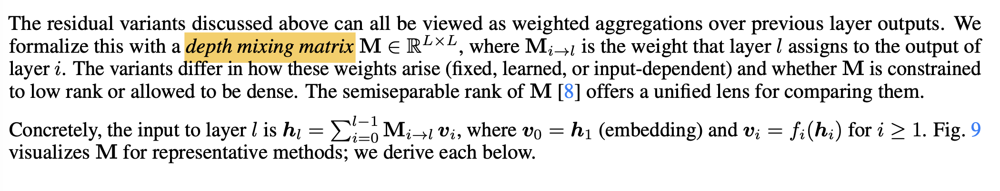
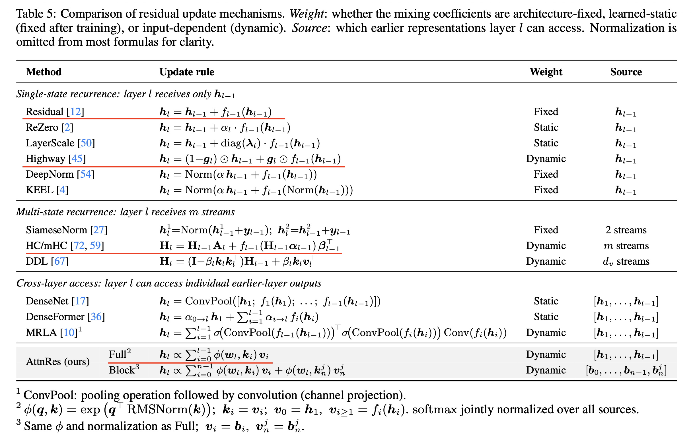
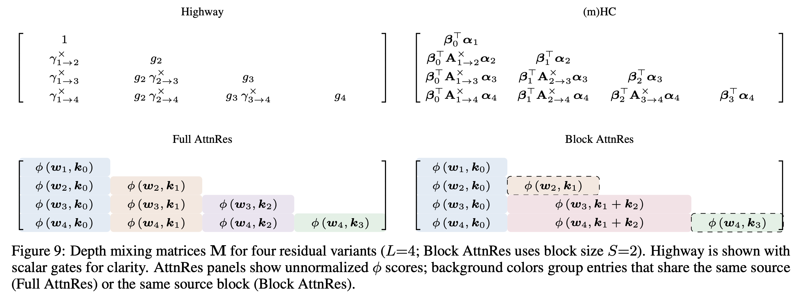
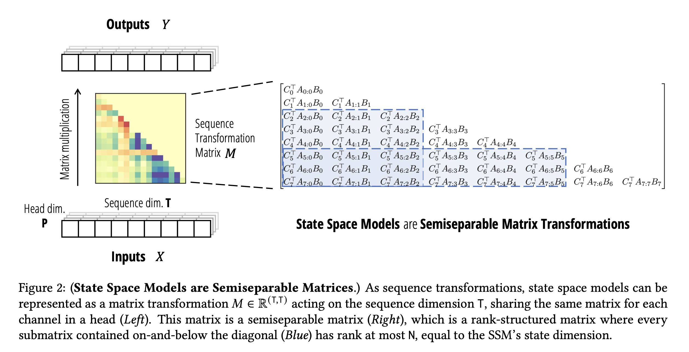
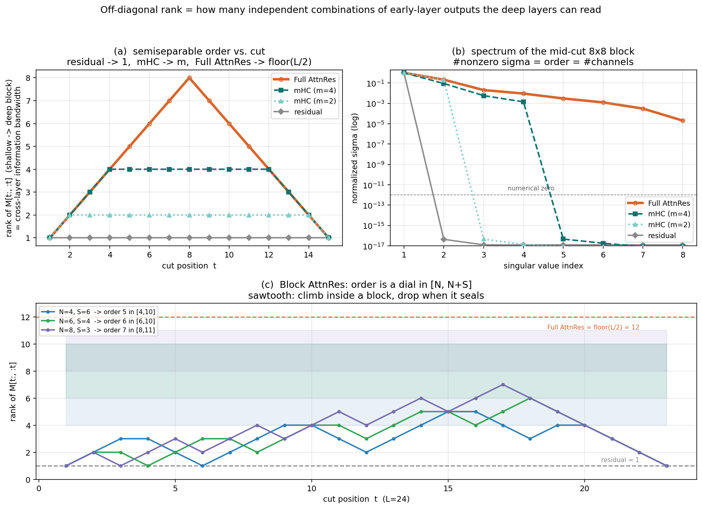
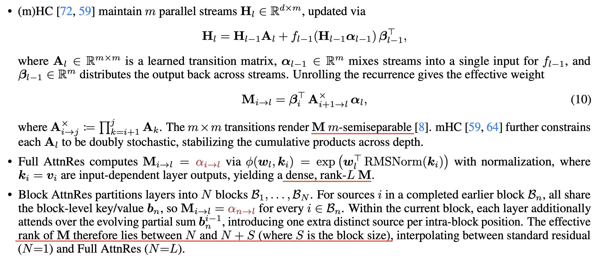
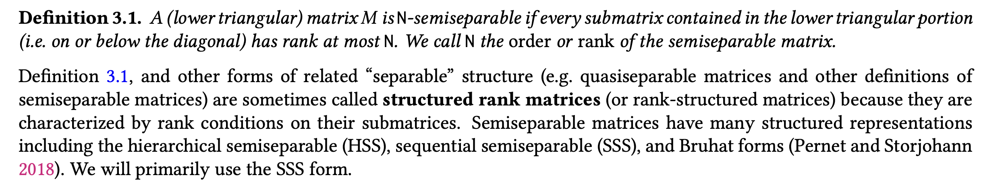
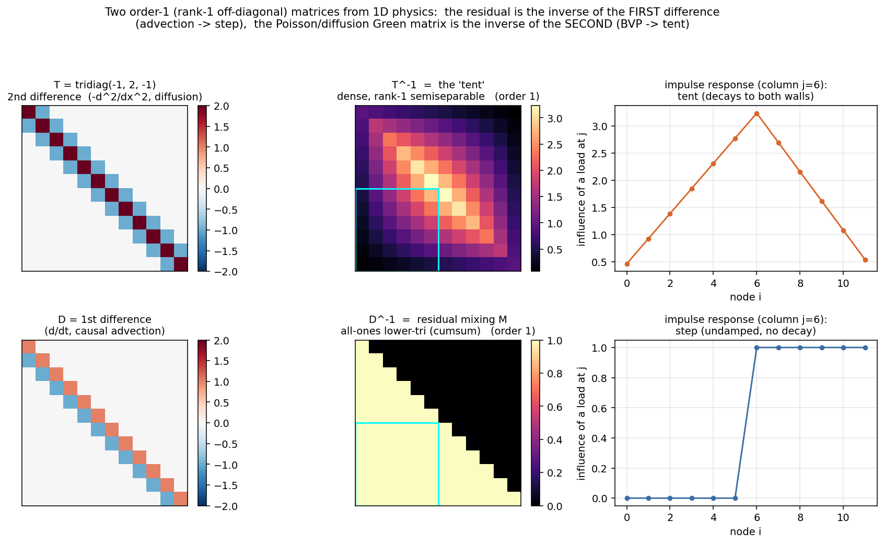
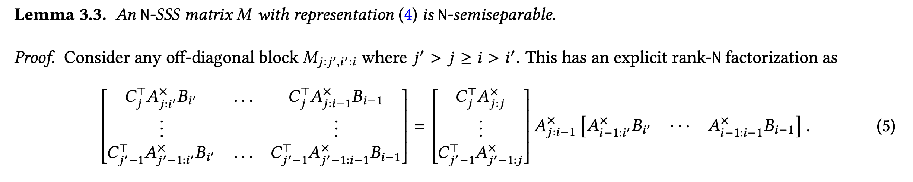
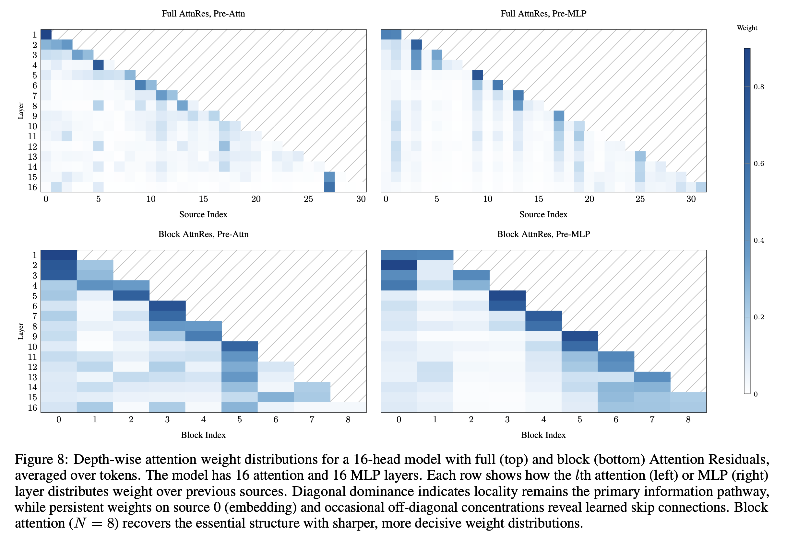

# Understanding the information capacity of mHC and AttnRes from a matrix view

Chinese version: [residual_analysis_zh.md](residual_analysis_zh.md)

With the Kimi-K3 weights out, I went back through the [Attention Residuals (AttnRes) paper](https://arxiv.org/abs/2603.15031), and that also clarified the math behind [DS-V4 mHC](https://arxiv.org/abs/2512.24880).

Section 6.2 of AttnRes, "Residual Connections as Structured Matrices", sketches some neat matrix properties of residual variants (including mHC and block AttnRes), but does not really unpack them. This post fills in the proofs, checks them in code, works a few concrete examples, and ties the story back to classical numerical analysis / physics.

There is more to say on the infra side of residual redesigns — pipeline parallelism, recomputation, and so on. That is for a later post.

# Outline

- [Notation](#notation)
- [A matrix view of residual connections](#matrix-view)
  - [Recurrent vs matrix forms for Residual, mHC, AttnRes](#recurrent-and-matrix)
  - [The surprising parallel with linear attention](#linear-attention)
- [Numerical experiment: measuring cross-layer information (off-diagonal rank)](#numerical-rank)
- [A sharper definition and the proofs (semi-separable order)](#semisep-order)
  - [Where semi-separable matrices come from](#semisep-history)
  - [SS order of mHC](#mhc-proof)
  - [SS order of AttnRes](#attnres-proof)
- [References](#references)

<a id="notation"></a>
# Notation

Notation varies across papers: the expansion factor is $n=4$ in the mHC paper and $m$ in AttnRes; hidden states are written $x$ or $h$; mHC's projection matrices are sometimes $\mathcal H_{\text{pre}}/\mathcal H_{\text{post}}/\mathcal H_{\text{res}}$, sometimes $\alpha/\beta/A$. To avoid mixing them, this post **sticks to AttnRes notation** and records the mHC-paper counterparts in the table:

| Symbol | Meaning | Counterpart in the mHC paper |
|---|---|---|
| $L$ | Total number of Transformer layers (FFN and Attention each count as one) | — |
| $l,\,i$ | Layer indices; $l$ is the **receiving** layer, $i$ the **source** layer, always $i\le l$ | — |
| $\mathbf h_l\in\mathbb R^{d}$ | Input hidden state to layer $l$ | — |
| $f_l(\cdot)$ | Nonlinear transform of layer $l$ (Attention or FFN forward, without the residual add) | — |
| $\mathbf v_l\in\mathbb R^{d}$ | Layer- $l$ output $f_l(\mathbf h_l)$; by convention $\mathbf v_0=\mathbf h_1$ is the embedding | $v_i$ |
| $d$ | Hidden dimension | — |
| $m$ | mHC stream expansion factor (DS-V4 uses $4$) | Written $n$ in the original |
| $\mathbf M\in\mathbb R^{L\times L}$ | **Depth Mixing Matrix**, (strictly) lower triangular; $\mathbf M_{l,i}$ = weight that receiving layer $l$ assigns to source output $\mathbf v_i$, so $\mathbf h_l=\sum_{i\lt l}\mathbf M_{l,i}\mathbf v_i$ | Written $\mathbf M_{i\to l}$ |
| $\boldsymbol\alpha_l,\,\boldsymbol\beta_i\in\mathbb R^{m}$ | mHC read / write projection vectors | $\mathcal H_{\text{pre}}=\alpha$ (mix $m$ streams into the layer input), $\mathcal H_{\text{post}}=\beta$ (write the output back into the streams) |
| $\mathbf A_k\in\mathbb R^{m\times m}$ | mHC stream transition matrix (constrained to be doubly stochastic) | $\mathcal H_{\text{res}}$ |
| $\mathbf w_l,\,\mathbf k_i\in\mathbb R^{d}$ | Full AttnRes query / key | — |
| $\phi(\mathbf w,\mathbf k)=\exp(\mathbf w^{\!\top}\mathbf k)$ | AttnRes (softmax) kernel | — |
| $N,\,S$ | Block AttnRes: number of blocks / block size, $N=L/S$ | — |
| $t$ | Cut position: split layers $1..t$ from layers $t{+}1..L$ | — |
| SS order | Semiseparable order: max rank over all off-diagonal blocks $\mathbf M[t{:},{:}t]$ | — |

<a id="matrix-view"></a>
# A matrix view of residual connections

<a id="recurrent-and-matrix"></a>
## Recurrent vs matrix forms for Residual, mHC, AttnRes

Start with plain residual. Unrolling $\mathbf h_l=\mathbf h_{l-1}+\mathbf v_{l-1}$ gives $\mathbf h_l=\sum_{i\lt l}\mathbf v_i$: the input to layer $l$ is an equal-weight sum of every earlier layer's output. Packing all $\mathbf h_l$ and $\mathbf v_i$ into one matrix equation:

```math
\mathbf{h}_l=\sum_{i\lt l}\mathbf{v}_i
\quad\Longleftrightarrow\quad
\mathbf{H}=\mathbf{M}^{\mathrm{res}}\mathbf{V},\qquad
\mathbf{M}^{\mathrm{res}}=\begin{bmatrix}
0 & 0 & 0 & 0 & 0 \\
1 & 0 & 0 & 0 & 0 \\
1 & 1 & 0 & 0 & 0 \\
\vdots & & \ddots & \ddots & \\
1 & 1 & \cdots & 1 & 0
\end{bmatrix}.
```

This strictly lower-triangular all-ones matrix is just the discrete cumulative-sum operator — the same shape as a causal mask along the sequence axis. A quick numpy check that the recurrence equals the matrix multiply:

```python
import numpy as np
rng = np.random.default_rng(0)
L, d = 6, 5
V = rng.standard_normal((L, d))
H_rec = np.zeros((L, d))
for l in range(1, L):
    H_rec[l] = H_rec[l-1] + V[l-1]              # layerwise: h_l = h_{l-1} + v_{l-1}
M_res = np.tril(np.ones((L, L)), -1)            # strictly lower-triangular ones
assert np.allclose(H_rec, M_res @ V)            # unrolled recurrence == matmul
```

> **Footnote (about the diagonal of the lower triangle).** This post indexes receiving and source layers with the same counter ($\mathbf h_l=\sum_{i\lt l}\mathbf M_{l,i}\mathbf v_i$), so $\mathbf M$ is *strictly* lower triangular: the diagonal entry $\mathbf M_{l,l}=0$, because layer $l$ cannot read its own not-yet-computed output $\mathbf v_l$. Figure 9 of AttnRes instead puts embedding $\mathbf v_0$ in column 0 and $\mathbf h_1$ in row 0, shifting row and column indices by one. The "read previous layer" weight (1 for plain residual, $\boldsymbol\beta_{l-1}^{\!\top}\boldsymbol\alpha_l$ for mHC) then lands on the main diagonal, and the plot becomes a lower triangle *with* a diagonal (plain residual is exactly the invertible all-ones cumsum matrix). Same map, just a one-step column shift. SS order later only looks at strictly lower-triangular off-diagonal blocks, so the diagonal convention does not matter — both agree.

More generally: **any residual variant can be written** $\mathbf h_l=\sum_{i\lt l}\mathbf M_{l,i}\,\mathbf v_i$, where $\mathbf M_{l,i}$ is the weight that receiving layer $l$ gives to the output of source layer $i$. That lower-triangular matrix $\mathbf M$ is the **Depth Mixing Matrix**. Variants differ in how $\mathbf M$ is produced — fixed constants, learned parameters, or input-dependent dynamics:



Plain residual has $\mathbf M$ all ones. mHC, AttnRes, and earlier ideas like [Highway Residual](https://arxiv.org/abs/1612.07771) put more expressive weights on the same matrix. From the AttnRes summary table:



The paper draws the $\mathbf M$ for several highlighted variants — much richer than the all-ones lower triangle:



**Full AttnRes: softmax attention along depth.** An intuitive, expressive upgrade: give each receiving layer $l$ a learnable query $\mathbf w_l$, and run softmax attention over all earlier layer outputs, with weights depending on the dynamic input:

$$\mathbf M^{\text{Attn}}_{l,i}=\frac{\exp\!\big(\mathbf w_l^{\!\top}\mathbf k_i\big)}{\sum_{j\lt l}\exp\!\big(\mathbf w_l^{\!\top}\mathbf k_j\big)},\qquad \mathbf k_i=\mathrm{RMSNorm}(\mathbf v_i).$$

(The RMSNorm on $\mathbf k_i$ is an engineering detail; it does not change the matrix structure we care about, so we ignore it below.) This is Full AttnRes in Figure 9: an entire row of softmax weights, with no low-rank constraint.

**mHC: widen the residual stream into $m$ streams.** mHC (or the original Hyper-Connections) does not put softmax on the depth axis. It widens the residual state: a state $\mathbf H_l\in\mathbb R^{d\times m}$ is passed along depth, and each layer does three things — **read** (mix $m$ streams into a $d$-dim input $\mathbf H_{l-1}\boldsymbol\alpha_l$ with $\boldsymbol\alpha_l$), **write** (scatter $f$'s output back across streams with $\boldsymbol\beta_l^{\!\top}$), and **transition** (right-multiply by $\mathbf A_l$ so the $m$ streams mix):

$$\mathbf H_l=\mathbf H_{l-1}\mathbf A_l+\underbrace{f_{l-1}\!\big(\mathbf H_{l-1}\boldsymbol\alpha_{l-1}\big)}_{=\,\mathbf v_{l-1}\in\mathbb R^{d}}\boldsymbol\beta_{l-1}^{\!\top}.$$

Unrolling (after source $i$ writes in, every later step right-multiplies by an $\mathbf A$), the coefficient in front of each source $\mathbf v_i$ when reading $\mathbf h_l=\mathbf H_{l-1}\boldsymbol\alpha_l$ is

$$\boxed{\ \mathbf M^{\text{mHC}}_{l,i}=\boldsymbol\beta_i^{\!\top}\,\mathbf A^{\times}_{i+1\to l}\,\boldsymbol\alpha_l\ },\qquad
\mathbf A^{\times}_{i+1\to l}:=\mathbf A_{i+1}\mathbf A_{i+2}\cdots\mathbf A_l\ \ (l{=}i\text{: convention }I).$$

That is Eq. (10) in AttnRes (a $\pm1$ index shift depends on whether transition or write comes first; it does not change the conclusions). For $L=4$ it is the (m)HC lower triangle in Figure 9. Notice the shape: a row vector $\boldsymbol\beta_i^{\!\top}$, a product of matrices $\mathbf A^{\times}$, and a column vector $\boldsymbol\alpha_l$ sandwiching them. Coupling between any pair $i\to l$ is generated by the same chain of $m\times m$ transitions, with only the endpoint read/write vectors changing per layer. That structure is the key to the proofs below.

A short numpy check that the recurrence and the matrix form agree (random $\mathbf A$ is enough here; real mHC runs Sinkhorn to make $\mathbf A$ doubly stochastic, which affects deep numerical stability, not the algebraic structure):

```python
m = 4
alpha = rng.standard_normal((L, m)); beta = rng.standard_normal((L, m))
A = rng.standard_normal((L, m, m)) / np.sqrt(m)
def Aprod(i, l):                                 # A_{i+1} A_{i+2} ... A_l  (I if l<=i)
    Q = np.eye(m)
    for k in range(i+1, l+1): Q = Q @ A[k]
    return Q
M_mhc = np.array([[beta[i] @ Aprod(i, l) @ alpha[l] if i <= l else 0.
                   for i in range(L)] for l in range(L)])
H, x = np.zeros((d, m)), np.zeros((L, d))
for l in range(L):
    H = H @ A[l] + np.outer(V[l], beta[l])       # transition + write
    x[l] = H @ alpha[l]                          # read
assert np.allclose(x, M_mhc @ V)                 # layerwise recurrence == unrolled matrix form
```

<a id="linear-attention"></a>
## The surprising parallel with linear attention

Interestingly, this *layer-axis* matrix $\mathbf M$ has almost the same math — and the same family of variants — as the masked score matrix of attention along the *sequence* axis.

Line it up against the matrix view in the Mamba-2 paper: mHC's $\mathbf M$ looks essentially identical (and we prove they really are equivalent later):



For linear-attention background, see the [Mamba-2 blog](https://goombalab.github.io/blog/2024/mamba2-part2-theory/#causal-linear-attention) and [DeltaNet Explained](https://sustcsonglin.github.io/blog/2024/deltanet-1/). The fact we need: causal linear attention has two equivalent writings — a parallel matrix form and a linear recurrence:

$$
\underbrace{\mathbf O=\big(\mathbf L\circ\mathbf Q\mathbf K^{\!\top}\big)\mathbf V}_{\text{matrix / parallel form}}
\qquad\Longleftrightarrow\qquad
\underbrace{\mathbf S_t=\mathbf S_{t-1}+\mathbf v_t\mathbf k_t^{\!\top},\quad \mathbf o_t=\mathbf S_t\mathbf q_t}_{\text{recurrent form, state }\mathbf S\in\mathbb R^{d\times d}}.
$$

That duality — "matrix mixer $\Leftrightarrow$ finite-state recurrence" — is the core of semiseparable matrix theory (Mamba-2 SSD). Common upgrades:

- **Add decay / gating** (GLA, Mamba-2): $\mathbf S_t=a_t\mathbf S_{t-1}+\mathbf v_t\mathbf k_t^{\!\top}$, so the mask picks up a decay;
- **Add a matrix transition + rank-1 update** (DeltaNet): $\mathbf S_t=\mathbf S_{t-1}(\mathbf I-\beta_t\mathbf k_t\mathbf k_t^{\!\top})+\beta_t\mathbf v_t\mathbf k_t^{\!\top}$. The "state × transition + rank-1 write" shape is very close to mHC's recurrence — just swap the sequence axis for the depth axis: $\mathbf A_k(\mathcal H_{\text{res}})$ plays DeltaNet's transition, and $\boldsymbol\beta f(\cdot)$ plays the rank-1 write.

In short:

> **mHC is (gated / DeltaNet) linear attention, rotated 90°, running along depth; Full AttnRes is softmax attention, rotated 90°, running along depth.** The difference is the old long-sequence question — **linear vs softmax**.

The "rotate 90°" framing first showed up in the [Attention Residuals notes](https://spaces.ac.cn/archives/11664) — "HC is basically DeltaNet rotated 90 degrees" — moving the sequence-axis toolkit of linear attention (gating, delta rule, matrix-valued state, recurrence ↔ matrix duality) onto the depth axis. The analogy above just fills in the details (mHC ↔ gated/DeltaNet linear, Full AttnRes ↔ softmax). Strictly speaking, "DeltaNet on the depth axis" is [Deep Delta Learning (DDL)](https://arxiv.org/abs/2601.00417), which also appears in the variant table above.

<a id="numerical-rank"></a>
# Numerical experiment: measuring cross-layer information (off-diagonal rank)

With so many variants, how do you measure — quantitatively and visually — what they buy over plain residual? A simple experiment: pick a cut $t$ in an $L$-layer net, and ask how flexibly layers $1..t$ can pass information to layers $t{+}1..L$. That flexibility lives in one *off-diagonal block* of the Depth Mixing Matrix, $\mathbf M[t{:},\,{:}t]$ (the lower-left of the lower triangle: rows $\ge t$, columns $\lt t$). If every coefficient is 1, deeper layers can only take everything equally (plain residual). Freer coefficients mean more room to "pick and choose". And **the rank of $\mathbf M[t{:},\,{:}t]$ measures that freedom**:

- Plain residual: $\mathbf M[t{:},\,{:}t]$ is all ones, an outer product $\mathbf 1\mathbf 1^{\!\top}$, rank always 1 — least freedom.
- Full AttnRes: $\mathbf M[t{:},\,{:}t]$ comes from cross-layer softmax, with no low-rank constraint. The block is $(L{-}t)\times t$, so $\mathrm{rank}\le\min(t,\,L{-}t)$, peaking at $\lfloor L/2\rfloor$ when $t=L/2$ — most freedom.
- mHC: the max off-diagonal rank can be shown to be **exactly $m$** (next section) — larger $m$, more flexibility.
- Block AttnRes: sits between residual and Full AttnRes; larger $N$ means more flexibility (details later).

First, a numerical check. `numpy.linalg.matrix_rank` is SVD under the hood — count nonzero singular values of each block, sweep every cut $t$:

```python
import numpy as np
rng = np.random.default_rng(0)
L = 16
def rms(x): return x / np.sqrt((x**2).mean(-1, keepdims=True) + 1e-6)

# (1) residual: all-ones lower triangle
M_res = np.tril(np.ones((L, L)))

# (2) mHC, m streams: M[l,i] = beta_i^T (A_{i+1}...A_l) alpha_l
def M_mhc(m):
    a = rng.standard_normal((L, m)); b = rng.standard_normal((L, m))
    A = rng.standard_normal((L, m, m)) / np.sqrt(m)
    def P(l, i):
        Q = np.eye(m)
        for k in range(i+1, l+1): Q = Q @ A[k]
        return Q
    return np.array([[b[i] @ P(l, i) @ a[l] if i <= l else 0.
                      for i in range(L)] for l in range(L)])

# (3) Full AttnRes: softmax along depth
w = rng.standard_normal((L, 32)); k = rms(rng.standard_normal((L, 32)))
Lo = np.where(np.tril(np.ones((L, L))) > 0, w @ k.T, -np.inf)
M_attn = np.exp(Lo - np.nanmax(Lo, 1, keepdims=True))
M_attn = np.where(np.isfinite(Lo), M_attn, 0.); M_attn /= M_attn.sum(1, keepdims=True)

# semiseparable order = max rank of off-diagonal blocks over all cuts
order = lambda M: max(np.linalg.matrix_rank(M[t:, :t], tol=1e-9) for t in range(1, L))
print("residual :", order(M_res))         # 1
print("mHC m=2  :", order(M_mhc(2)))       # 2
print("mHC m=4  :", order(M_mhc(4)))       # 4
print("AttnRes  :", order(M_attn))         # 8 = floor(L/2)
```

Sweep the cut $t$ from $1$ to $L$, and look at the singular-value spectrum of the mid-cut block — the expressive power of each matrix is then obvious ((a) rank vs cut; (b) singular spectrum at the midpoint; (c) how Block AttnRes order moves inside $[N,N{+}S]$ as parameters change — see later):



This matches what AttnRes claims (without proof): residual stays at 1, mHC saturates at the stream count $m$, Full AttnRes climbs to $\lfloor L/2\rfloor$, and Block AttnRes sits in $[N,N{+}S]$:



A few clarifications:

- The "rank" here (and in AttnRes) is the rank of an *off-diagonal block* of $\mathbf M$, not of the whole matrix. Whole-matrix rank is not useful for this comparison (it mostly asks whether there is a diagonal / subdiagonal); what carries information is how large $\mathrm{rank}\,\mathbf M[t{:},\,{:}t]$ can get.
- The cut $t$ can be anything from $1$ to $L{-}1$. We sweep all $t$ and take the max-rank block as an integer metric. Why `max` rather than `mean`? Either works as an empirical score, but `max` has a cleaner theory — next section.

<a id="semisep-order"></a>
# A sharper definition and the proofs (semi-separable order)

That "max rank over lower-triangular off-diagonal blocks" already has a name in numerical analysis: **semi-separable order**. From the Mamba-2 definition:



Some ML papers call it "semiseparable rank"; we follow the numerical-analysis name "semiseparable order" / "SS order".

<a id="semisep-history"></a>
## Where semi-separable matrices come from

An $n\times n$ lower-triangular matrix is **$k$-semiseparable** (Mamba-2 writes this order as $N$; to avoid clashing with matrix size $n$ and with Block AttnRes's $N$, we use $k$ here) if every sub-block strictly below the diagonal has rank at most $k$ — i.e. each such block factors as a "skinny" outer product $\mathbf U\mathbf V^{\!\top}$ ($\mathbf U,\mathbf V$ have only $k$ columns). When $k\ll n$, the matrix is highly structured: matmul, inversion, QR, and friends that normally cost $O(n^3)$ admit $O(n)$ (more precisely $O(kn)$ ) algorithms.

The classical source of these matrices is the **inverse of a 1-D difference operator** (Gantmacher & Krein; Vandebril et al.; see references). Example: a string fixed at both ends, under load $f$, has steady deflection $u$ solving Poisson's equation $-u''=f$. A three-point stencil for the second derivative gives a sparse tridiagonal $\mathbf T=\mathrm{tridiag}(-1,2,-1)$ (each node couples only to its neighbors — very local). Its inverse is **dense**, with a clean closed form:

$$\big(\mathbf T^{-1}\big)_{ij}=\frac{\min(i,j)\,\big(n{+}1-\max(i,j)\big)}{n+1}.$$

The punchline: take any off-diagonal block (influence of a left-half node $j$ on a right-half node $i$, $i\gt j$, so $\min=j$, $\max=i$). Each entry factors into "row-only × column-only":

$$\big(\mathbf T^{-1}\big)_{ij}=\underbrace{\tfrac{n{+}1-i}{n+1}}_{\text{row }i\text{ only}}\cdot\underbrace{j}_{\text{col }j\text{ only}}\quad(i\gt j),$$

so the whole block is a column vector times a row vector — an outer product, rank 1. Hence $\mathbf T^{-1}$ is 1-semiseparable. The physics is equally plain: between the load and a fixed end there is no other force, so the string is a straight line; every point left of the load lives on the same line segment, same shape up to a slope scalar — one number carries the entire effect of the load. That channel is rank 1.

Plain residual's $\mathbf M$ is the same story. $\mathbf h_l=\mathbf h_{l-1}+\mathbf v_l$ is a discrete first-order difference equation; its inverse is exactly the all-ones lower triangle (cumsum), again 1-semiseparable. Side by side (left: sparse local difference operator; middle: its dense inverse; right: impulse response):

```python
import numpy as np, sympy as sp
n = 6
T = sp.Matrix(n, n, lambda i, j: 2 if i == j else (-1 if abs(i-j) == 1 else 0))
Tinv = np.array(T.inv().tolist(), float)
c = n // 2; blk = Tinv[c:, :c]                       # left-half -> right-half off-diagonal block
u = (n+1 - np.arange(c+1, n+1)) / (n+1); v = np.arange(1., c+1)
assert np.allclose(blk, np.outer(u, v))              # block == outer product u v^T  -> rank 1  (Poisson / diffusion)

D = np.eye(n) - np.diag(np.ones(n-1), -1)            # first difference
assert np.allclose(np.linalg.inv(D), np.tril(np.ones((n, n))))   # D^-1 = all-ones lower triangle = residual
```



Both have rank 1, but different values: residual is a pure integrator — impulse response is a step (a signal from one layer is added with weight 1 at every later layer, never decaying); the Poisson inverse is a "tent" pinned at both ends, decaying linearly to the boundary. Order only counts *how many channels*, not how fast they decay. Residual's single channel is exactly the **running sum** (the residual stream itself) — which is why a full residual pass is one $O(L)$ forward, the same reason linear attention / SSMs get linear complexity.

<a id="mhc-proof"></a>
## SS order of mHC

We now show that **mHC has SS order exactly $m$**. Recall the unrolled form

$$\mathbf M^{\text{mHC}}_{l,i}=\boldsymbol\beta_i^{\!\top}\big(\mathbf A_{i+1}\cdots\mathbf A_l\big)\boldsymbol\alpha_l.$$

> **Side note.** This "row vector – matrix product – column vector" writing is the SSS (sequentially semiseparable) *generator form* in numerical analysis — one of the standard representations of semiseparable matrices.

Fix a cut $t$ and look at the block $\mathbf M[t{:},\,{:}t]$ (rows $l\ge t$, columns $i\lt t$). Every entry $(l,i)$ has $i\lt t\le l$, so the transition product straddles $t$ and splits cleanly:

$$\mathbf A_{i+1}\cdots\mathbf A_l=\underbrace{\big(\mathbf A_{i+1}\cdots\mathbf A_t\big)}_{\text{depends only on col }i}\ \underbrace{\big(\mathbf A_{t+1}\cdots\mathbf A_l\big)}_{\text{depends only on row }l}.$$

With $t$ fixed, the left half depends only on $i$, the right half only on $l$. Each entry becomes an inner product of two $m$-vectors:

$$\mathbf M_{l,i}=\mathbf v_i^{\!\top}\mathbf u_l,\qquad
\mathbf u_l=\big(\mathbf A_{t+1}\cdots\mathbf A_l\big)\boldsymbol\alpha_l,\quad
\mathbf v_i=\big(\mathbf A_{i+1}\cdots\mathbf A_t\big)^{\!\top}\boldsymbol\beta_i.$$

Stack the $\mathbf u_l$ into $\mathbf U\in\mathbb R^{(L-t)\times m}$ and the $\mathbf v_i$ into $\mathbf V\in\mathbb R^{t\times m}$; the whole block is $\mathbf M[t{:},\,{:}t]=\mathbf U\mathbf V^{\!\top}$ — an outer product with inner dimension $m$, so $\mathrm{rank}\le m$ for every $t$. That is Lemma 3.3 of Mamba-2:



Conversely, as long as the generators are non-degenerate (almost always), $\mathbf U$ and $\mathbf V$ are column-full-rank, so the block rank is exactly $m$, not less — more formally, "some $m\times m$ minor is nonzero" is a non-identically-zero polynomial, vanishing only on a measure-zero set of parameters. Sandwiching both sides: **SS order $=m$**. Intuition: at the cut, only an $m$-dimensional state flows from shallow to deep layers, so at most $m$ pieces of shallow information can survive into the deep layers.

Check both claims with sympy (symbolically: block $=\mathbf U\mathbf V^{\!\top}$, and an $m\times m$ minor has non-zero determinant as a polynomial), then confirm numerically that the rank really is $m$ (not $m{-}1$):

```python
import sympy as sp, numpy as np
m, L, t = 2, 5, 3
A = [sp.Matrix(m, m, lambda r, c: sp.Symbol(f'a{k}_{r}{c}')) for k in range(L)]
B = [sp.Matrix(m, 1, lambda r, c: sp.Symbol(f'b{k}_{r}')) for k in range(L)]
C = [sp.Matrix(m, 1, lambda r, c: sp.Symbol(f'c{k}_{r}')) for k in range(L)]
def Ap(i, l):                                    # A_{i+1} ... A_l
    P = sp.eye(m)
    for k in range(i+1, l+1): P = P * A[k]
    return P
M   = sp.Matrix(L, L, lambda l, i: (B[i].T * Ap(i, l) * C[l])[0] if i <= l else 0)
blk = M[t:, :t]
U = sp.Matrix.hstack(*[Ap(t, l) * C[l] for l in range(t, L)])         # row factors u_l  (m x (L-t))
V = sp.Matrix.hstack(*[Ap(i, t).T * B[i] for i in range(t)])         # col factors v_i  (m x t)
assert sp.simplify(blk - U.T * V) == sp.zeros(*blk.shape)            # block == U^T V  -> rank <= m
assert sp.simplify(M[2:4, 0:2].det()) != 0                          # m x m minor is a nonzero poly -> generic rank = m

rng = np.random.default_rng(0); mm, LL, ct = 3, 12, 6
a = rng.standard_normal((LL, mm)); b = rng.standard_normal((LL, mm)); Ar = rng.standard_normal((LL, mm, mm))
def P(i, l):
    Q = np.eye(mm)
    for k in range(i+1, l+1): Q = Q @ Ar[k]
    return Q
Mn = np.array([[b[i] @ P(i, l) @ a[l] if i <= l else 0. for i in range(LL)] for l in range(LL)])
assert np.linalg.matrix_rank(Mn[ct:, :ct], tol=1e-9) == mm          # numerical: block rank is exactly m
```

This is the depth-axis twin of "a linear-attention / SSM with state size $m$ is exactly $m$-semiseparable". Only in degenerate cases — all $\boldsymbol\beta_i$ collinear, or $\mathbf A$ collapsing the state into a lower-dimensional subspace — does the order drop below $m$. A well-trained mHC whose streams have not collapsed will not hit those cases, so "order equals $m$" is the generic statement.

The same conclusion holds for **mHC-lite**. [mHC-lite](https://arxiv.org/abs/2601.05732) keeps mHC's full recurrence and only changes how $\mathbf A$ is built: from a Sinkhorn approximation of doubly-stochastic matrices to an exact convex combination of permutations (Birkhoff–von Neumann). SS order depends only on the state dimension $m$; HC / mHC / mHC-lite all use $m{=}4$, so the same derivation gives order $m$. Constraints on $\mathbf A$ (none / approximate / exact doubly-stochastic) govern stability, not order.

<a id="attnres-proof"></a>
## SS order of AttnRes

**Full AttnRes is full order, and has no finite SSS representation.** Put bluntly: once you have softmax and an exponential, you can no longer force a low-rank structure. The reason: the softmax kernel $\phi(\mathbf q,\mathbf k)=\exp(\mathbf q^{\!\top}\mathbf k)$ admits no finite-dimensional feature map $\varphi$ with $\exp(\mathbf q^{\!\top}\mathbf k)=\varphi(\mathbf q)^{\!\top}\varphi(\mathbf k)$. Contrast linear attention: scores first pass through a **fixed $r$-dim feature map $\varphi$** ($\varphi$ may be nonlinear) and then take an inner product, so $\mathbf M_{\text{lin}}=\varphi(\mathbf Q)\varphi(\mathbf K)^{\!\top}$ necessarily has rank $\le r$, independent of depth $L$; softmax's $\exp(\mathbf Q\mathbf K^{\!\top})$ never goes through a finite feature map, and the entrywise $\exp$ scatters any low-rank structure into full rank. Check with a real linear-attention feature map (elu+1) — $\varphi$ is nonlinear, yet $\mathbf M_{\text{lin}}$ still sits at rank $r$ ($=4\ll L$), while softmax is full rank:

```python
import numpy as np
rng = np.random.default_rng(0)
L, r = 8, 4
Q = rng.standard_normal((L, r)); K = rng.standard_normal((L, r))
phi = lambda x: np.where(x > 0, x + 1.0, np.exp(x))     # elu+1 feature map (nonlinear), R^r -> R^r
M_lin  = phi(Q) @ phi(K).T                              # inner product in r-dim features -> rank <= r
M_soft = np.exp(Q @ K.T)                                # softmax kernel (unnormalized)
print(np.linalg.matrix_rank(M_lin,  tol=1e-9))    # 4 = r   (linear kernel, << L=8)
print(np.linalg.matrix_rank(M_soft, tol=1e-9))    # 8 = L   (softmax kernel, full)
```

So every AttnRes off-diagonal block is full rank, and SS order hits the maximum a causal $L\times L$ matrix can have:

$$\text{order}=\max_{t}\ \mathrm{rank}\,\mathbf M[t{:},\,{:}t]=\max_t\ \min(t,\,L{-}t)=\big\lfloor L/2\big\rfloor.$$

Figure 8 of the paper — real depth-attention maps — matches this "dense but structured" look (near-diagonal locality + an attention sink on the embedding column):



**Block AttnRes is the engineering compromise, with order in $[N,N{+}S]$.** Every $S$ layers are collapsed into a block-summary (plain residual sum), and attention runs only over the $N=L/S$ summaries. A sharp rank proof is awkward, but the mechanism is clear and easy to check numerically:

- Inside a sealed block, $S$ sources share one block-level key, so the corresponding $S$ columns of $\mathbf M$ are identical — each sealed block contributes rank 1, at most $N$ channels in total;
- Inside the still-open current block, layers still attend source-by-source, adding at most $S$ more channels.

Together: order $\in[N,N{+}S]$. $N{=}1$ collapses to plain residual; $N{=}L$ approaches Full AttnRes. Numerically, sealed blocks really are rank 1, and the upper bound $N{+}S$ holds for every random seed we tried (actual order hugs $N$, always below Full AttnRes's $\lfloor L/2\rfloor$):

```python
import numpy as np
rng = np.random.default_rng(0)
def rms(x): return x / np.sqrt((x**2).mean(-1, keepdims=True) + 1e-6)
def M_block_attn(L, S):                          # N = L // S blocks, each of size S
    B = L // S; d = 32
    kblk = rms(rng.standard_normal((B, d)))       # one shared key per sealed block
    ksrc = rms(rng.standard_normal((L, d)))       # per-source key inside the current block
    w = rng.standard_normal((L, d)); M = np.zeros((L, L))
    for l in range(L):
        bl = l // S
        lg = [w[l] @ kblk[b] for b in range(bl)] + [w[l] @ ksrc[i] for i in range(bl*S, l+1)]
        a = np.exp(np.array(lg) - max(lg)); a /= a.sum()
        for b in range(bl): M[l, b*S:(b+1)*S] = a[b]     # sealed block: S identical columns -> rank 1
        M[l, bl*S:l+1] = a[bl:]                          # current block: per source
    return M
order = lambda M: max(np.linalg.matrix_rank(M[t:, :t], tol=1e-9) for t in range(1, M.shape[0]))
assert np.linalg.matrix_rank(M_block_attn(24, 4)[8:, 0:4], tol=1e-9) == 1   # sealed block is rank 1
for L, S in [(16, 4), (24, 4), (32, 4)]:
    N = L // S; ords = [order(M_block_attn(L, S)) for _ in range(30)]
    assert all(o <= N + S for o in ords)          # upper bound N+S always holds
    print(f"L={L} S={S} N={N}: order in {min(ords)}..{max(ords)} <= N+S={N+S}, band [{N},{N+S}]")
    # output: L=16 S=4 N=4: order in 4..4 <= 8, band [4,8]
    #         L=24 S=4 N=6: order in 6..6 <= 10, band [6,10]
    #         L=32 S=4 N=8: order in 7..7 <= 12, band [8,12]
```

That is subplot (c) of the figure in the numerical section: for $L{=}24$ with $N{=}4,6,8$, each curve is sawtooth in the cut (climbs inside a block, drops when the block seals), peaks inside the shaded $[N,N{+}S]$ band, and the whole curve lifts as $N$ grows — always between residual's $1$ and Full AttnRes's $\lfloor L/2\rfloor$. So Block AttnRes uses $N$ as a knob on expressivity: larger $N$ lets deep layers pick more selectively from shallow information, at the cost of more summaries to carry across the cut.

<a id="references"></a>
# References

- Attention Residuals — [arXiv:2603.15031](https://arxiv.org/abs/2603.15031) (Table 5 & Fig. 9: residual variants as structured matrices)
- mHC: Manifold-Constrained Hyper-Connections — [arXiv:2512.24880](https://arxiv.org/abs/2512.24880); Hyper-Connections — [arXiv:2409.19606](https://arxiv.org/abs/2409.19606); mHC-lite — [arXiv:2601.05732](https://arxiv.org/abs/2601.05732)
- Dao & Gu, *Transformers are SSMs* (SSD / Mamba-2) — [arXiv:2405.21060](https://arxiv.org/abs/2405.21060); [theory blog](https://goombalab.github.io/blog/2024/mamba2-part2-theory/); [DeltaNet Explained](https://sustcsonglin.github.io/blog/2024/deltanet-1/)
- Vandebril, Van Barel & Mastronardi, *Matrix Computations and Semiseparable Matrices* (Johns Hopkins UP, 2008); Gantmacher & Krein, *Oscillation Matrices and Kernels* — classical origins of semiseparable matrices and $O(n)$ algorithms
