# Is SIMT easier to program than SIMD? In-depth comparison based on TileKernels/quant kernels

The [original Chinese blog](quant_simt_simd_compare_zh.md) was **typed entirely by hand without AI**. This English translation was produced with AI assistance plus human edits. AI agents were used only for the example-code repository, which reproduces the results in this article:
- The CA model simulates the VF of a single-core kernel, so you can run it even without an NPU card; with Dockerfile to make results easily reproducible: https://github.com/PTO-ISA/tilelang-puzzles-ascend/tree/simt_compare
- Full multicore pipeline and on-device execution: https://github.com/PTO-ISA/TileKernels-PTO

Based on official DeepSeek examples:
- https://github.com/tile-ai/tilelang/blob/v0.1.15/tilelang/ascend/README.md
- https://github.com/deepseek-ai/TileKernels/tree/v2.1.0-release/tile_kernels/quant

# Motivation

For years, I could not understand why so many people blamed the "difficulty of NPU programming" on "the lack of CUDA/SIMT support." After all, once CUDA code starts using warp shuffle/vote/sync/mma, doesn't it also lose much of SIMT's convenience? And people have been hand-writing AVX/Neon/SVE on CPUs for more than a decade without making the same complaint. What does make a "SIMD NPU" harder to program than a "SIMD CPU" is software pipelining. Fortunately, [TileLang now supports Ascend natively](https://github.com/tile-ai/tilelang/blob/v0.1.15/tilelang/ascend/README.md): kernel engineers can use `T.Pipelined` to schedule software pipelines automatically instead of suffering from hand-arranged `set_flag`/`wait_flag` and cross-core-flag semaphores. (thanks DeepSeek, the open-source king!)

However, NPU kernels still look more complicated than CUDA kernels. In DeepSeek's open-source [TileKernels examples](https://github.com/deepseek-ai/TileKernels/tree/v2.1.0-release/tile_kernels/), each `*_asc.py` kernel implementation is **roughly twice as long** as its `*_cuda.py` counterpart. Software pipelining is no longer to blame—`T.Pipelined`, `T.Persistent`, `T.Stage`, and friends already hide it. The extra length instead comes from extensive use of low-level SIMD instructions inside `with T.SimdVF():`, such as `vld`, `vsts`, `vadds`, and `vdup` (see [`tilelang.ascend.language.simd`](https://github.com/tile-ai/tilelang/blob/v0.1.15/tilelang/ascend/language/simd.py)). GPU code, by contrast, uses scalar-granularity operations inside a `T.Parallel` scope and thus looks simpler. This article avoids subjective positions in the SIMD-vs-SIMT debate and examines concrete algorithmic patterns to determine where the syntactic gap actually comes from.


Ascend 950 supports [hybrid SIMD and SIMT programming](https://www.hiascend.com/document/detail/zh/canncommercial/latest/programug/Ascendcopdevg/atlas_ascendc_10_10052.html), as illustrated above. We can therefore implement the same kernel once in SIMD and once in SIMT, then compare them line by line. The SIMT programming experience resembles early CUDA, but its performance is worse than SIMD; measurements appear later in this article. Unlike CUDA optimization, getting coalescing right does not close the gap because instruction throughput itself differs. SIMT mode also lacks some instructions: FP4 conversion, for example, is available only in SIMD mode. For SIMD mode, we should further distinguish between "**SIMD itself** is hard to program" (a bold conclusion) and "**ASC/CCE's SIMD abstraction** is too low-level and therefore hard to program" (a more cautious conclusion that leaves the SIMD conceptual model still usable).

To contribute to the TileLang community, the PTO team has explored two approaches:
- The first option remains within the SIMD programming model, but abstracts away the awkward SIMD instructions in ASC/CCE so that programming feels more like SIMD on a CPU. This is the [PTO Virtual micro Instruction (pto.vmi)](https://github.com/PTO-ISA/PTO-Gym/blob/main/docs/PTO-vmi-Instruction-SPEC.md). With TileLang's community PTO backend, [codegen_pto.cc](https://github.com/tile-ai/tilelang/blob/main/src/ascend/codegen/codegen_pto.cc), users can set `target='pto'` to generate PTO-DSL from TileLang code (similar to the TileLang -> CuTe DSL lowering path; both share the [CodeGenTileLangPY](https://github.com/tile-ai/tilelang/blob/424792eba01d887805fda8f71c847aa7749e6643/src/ascend/codegen/codegen_pto.h#L22) base class), or dump and directly modify the [lower-level PTO-DSL](https://github.com/hw-native-sys/PTOAS/blob/v0.68/ptodsl/docs/user_guide/14-vmi-virtual-instruction-set.md).
- The second option creates a more SIMT-like illusion for users by allowing SIMT-style scalar syntax such as `T.Parallel`, leaving more of the difficulty to the compiler; see [PR 3512](https://github.com/tile-ai/tilelang/pull/3512). (Getting a feeling of the ancient cursed thesis topic called "SIMT-to-SIMD transpilation"? Fortunately, we do not need to compile all of CUDA to SIMD NPU. Only the Tilelang DSL code inside a Vector Function. Our excellent compiler team can handle it.)

These designs are from many colleagues working day and night (check the TileLang Git committers yourself; I am not stealing anyone's credit). One contribution of mine was an early [PTO-DSL frontend prototype](https://github.com/huawei-csl/pto-dsl) that I hacked together at the beginning of this year. It showed that a lightweight Python -> MLIR approach is sufficient for developing NPU kernels, without depending on the heavyweight BiSheng/Clang frontend. It also showed that the framework layer could remain *thin, transparent, and easy to hack*. The DSL was subsequently refactored and optimized, then merged into the open-source [PTO Assembler](https://github.com/hw-native-sys/PTOAS) and official CANN packages released after September 30.

# Outline

- [Why Start with Quantization Algorithms](#why-quantize)
    - [Mathematical Refresher](#math-basics)
    - [Quantization Variants](#quant-variants)
    - [Minimal PyTorch Examples](#torch-examples)
- [Classification by Operation Pattern](#patterns)
    - [Cases Where SIMD Is Already Simple and Intuitive](#simd-simple)
    - [Cases Where SIMT and SIMD Differ Only Slightly](#simt-simd-similar)
    - [Cases Where SIMT Has a Small Advantage](#simt-slight-advantage)
    - [Cases Where SIMT Has a Clear Advantage](#simt-clear-advantage)
    - [Special Cases](#special-cases)
- [Performance Comparison (VF Simulation)](#perf-vf)
- [Open Questions](#open-questions)

<a id="why-quantize"></a>
# Why Start with Quantization Algorithms

First, quantization kernels make up a large share of TileKernels' Ascend support. That support appeared in the release open-sourced over China's National Day holiday; see [tile_kernels/quant](https://github.com/deepseek-ai/TileKernels/tree/v2.1.0-release/tile_kernels/quant). These are useful real-world kernels with meaningful complexity. The FP8 cast, for example, accounts for output memory layout and DeepGEMM alignment so it can be used directly downstream. Performance is also good. On large shapes, it reaches roughly 80% of the 950DT roofline (see the [benchmark](https://github.com/tile-ai/tilelang/blob/v0.1.15/tilelang/ascend/README.md#benchmark)). This is already far beyond what 950PR requires: the kernel is HBM-bound rather than vector-bound. [SemiAnalysis's performance measurements](https://newsletter.semianalysis.com/i/218361806/from-fast-kernels-to-reusable-kernel-engineering) show TileLang's quantization kernels running several times faster than Triton-Ascend, and its dequantization kernels several times faster than the built-in CANN kernels.

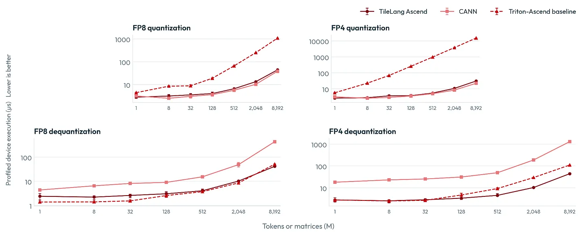

Second, the official ops-nn AscendC implementations of similar quantization kernels are unreasonably lengthy, leaving plenty of room for syntax improvement:
- MXFP quantization: one core file is 1,600 lines, not counting templates for other variants: https://gitcode.com/cann/ops-nn/blob/master/quant/dynamic_mx_quant/op_kernel/arch35/dynamic_mx_quant_tail_axis.h
- MXFP dequantization: one core file is 800 lines: https://gitcode.com/cann/ops-nn/blob/master/quant/anti_mx_quant/op_kernel/arch35/anti_mx_quant_tail_axis.h

These kernels have an interesting property: their mathematics is simple -- far simpler than fused kernels such as attention or MoE. Basically: per-group `reduce_max`, group multiply by a scale, dtype conversion, and then packing the scaling factors to save memory; dequantization simply reverses the order and omits the reduction. The PyTorch version takes ten lines, and the CUDA code is not complicated either. Its only ugly spot would be hand-written `__shfl_*_sync`, but TileLang conveniently hides warp operations behind primitives such as `T.reduce_*`. Yet the NPU implementation becomes excessively verbose: even after TileLang removes much of the complexity, manipulating SIMD registers still takes 100–200 lines each kernel. AscendC also requires hand-written pipelines and templates, so naturally it grows into the thousand lines.

Quantization on Ascend 950 always needs [`Reg::Interleave`](https://gitcode.com/cann/asc-devkit/blob/v9.1.1/docs/api/SIMD-API/%E5%9F%BA%E7%A1%80API/Reg%E7%9F%A2%E9%87%8F%E8%AE%A1%E7%AE%97/MaskReg%E8%AE%A1%E7%AE%97/Interleave-11.md) (`S.vintlv`), [`Reg::Deinterleave`](https://gitcode.com/cann/asc-devkit/blob/v9.1.1/docs/api/SIMD-API/%E5%9F%BA%E7%A1%80API/Reg%E7%9F%A2%E9%87%8F%E8%AE%A1%E7%AE%97/MaskReg%E8%AE%A1%E7%AE%97/DeInterleave-12.md) (`S.vdintlv`), and related operations such as `Reg::LoadDist::DIST_DINTLV_B32` (`S.vld2(..., dist="DINTLV_B32")`). This is because a SIMD register is always 256 bytes long, regardless of type (FP32/FP16/BF16/FP8), so a type cast changes the **number** of registers rather than their **length**. That is why the [`T.vcvt` parameters](https://github.com/tile-ai/tilelang/blob/v0.1.15/tilelang/ascend/language/simd.py#L1247-L1251) include `PART_EVEN`/`PART_ODD`, and even `PART_P0`/`PART_P1`/`PART_P2`/`PART_P3`. The [AscendC `Reg::Cast` documentation](https://gitcode.com/cann/asc-devkit/blob/9.1.0/docs/en/api/SIMD-API/basic_api/reg_vector_compute/type_conversion/Cast-45.md#constraints) illustrates this:

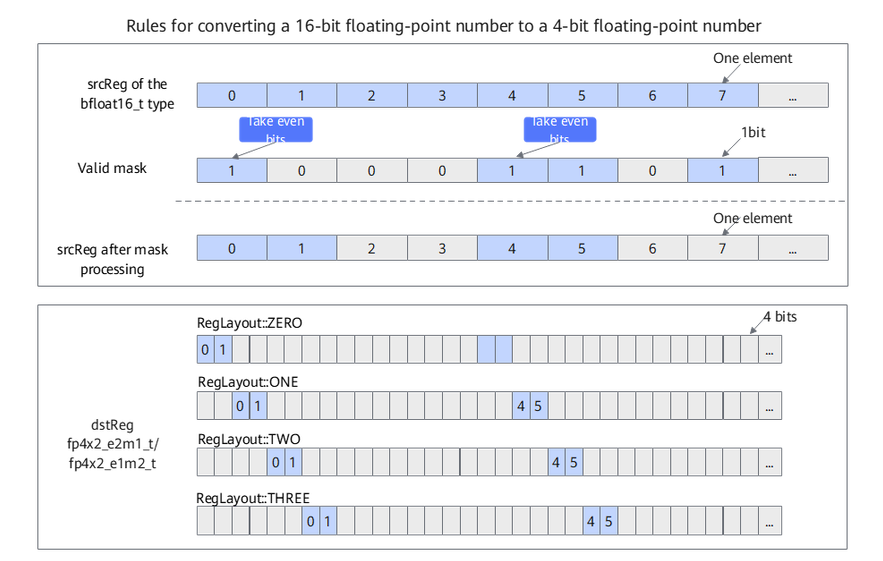

To handle these odd/even interleaved parts, `vintlv`/`vdintlv` must frequently convert them into layouts preferred by other SIMD compute or store instructions, as illustrated below:

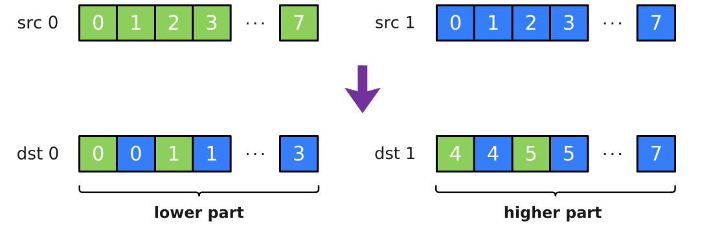
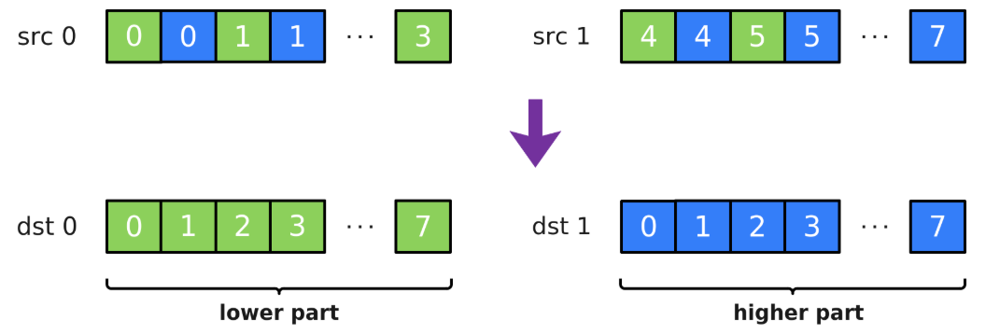

One key simplification in `pto.vmi` is to make `vcvt` change the register's length while keeping the number of (virtual) registers at one. This gives programmers a mental model closer to PyTorch's `.to(dtype)` or NumPy's `.astype`. Is that simple enough? Let us work through concrete examples.

<a id="math-basics"></a>
# Mathematical Refresher

<a id="quant-variants"></a>
## Quantization Variants

Set aside mixed precision, presorting, rotations, vector quantization, and other fancy tricks. For ordinary groupwise quantization, only two choices remain: how many values each scaling factor covers (by row, by column, or by both; and the block size), and the scaling factor's precision format (E8M0, FP32, etc.). The following figures show the three cases in `TileKernels/quant`: `per_token_cast`, `per_channel_cast`, and `per_block_cast`.

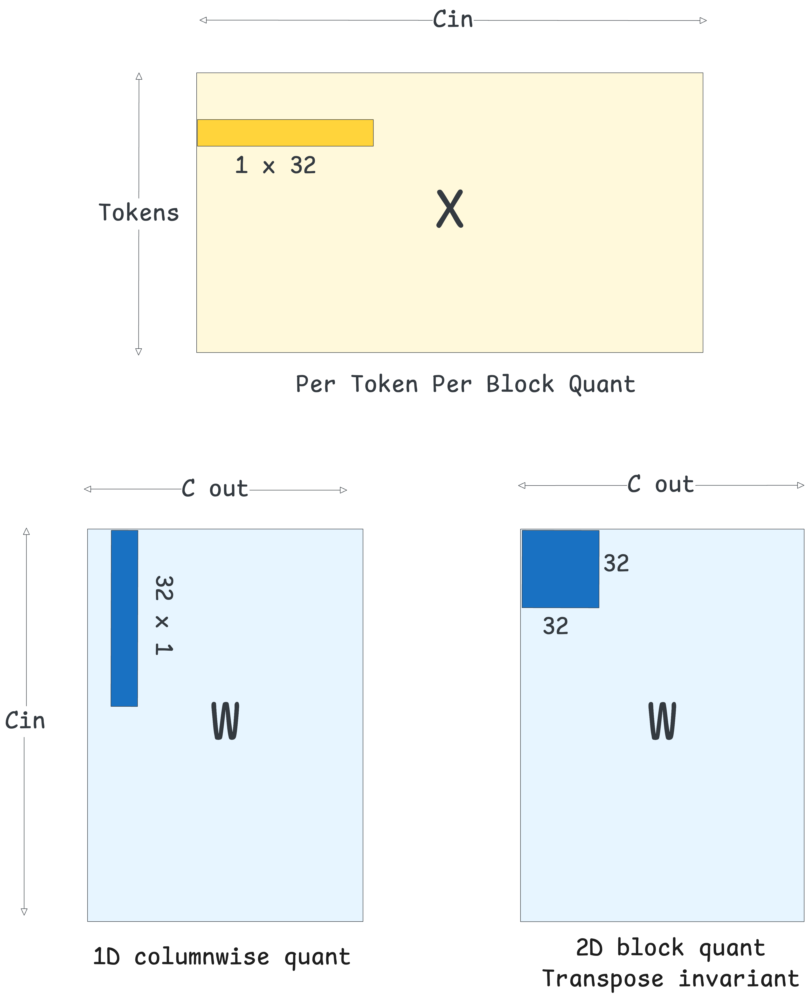

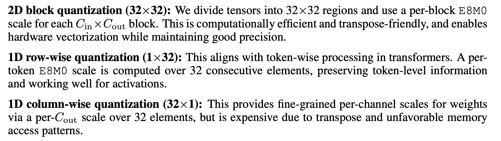

(Screenshots from the paper [Pretraining large language models with MXFP4 on Native FP4 Hardware](https://arxiv.org/abs/2605.09825).)

`TileKernels/quant` contains more advanced variants:
- Whether the scaling factor (sf) is stored as `[batch, group]` or transposed to `[group, batch]` (`use_tma_aligned_col_major_sf=True`)
- Whether every pair of E8M0 scaling factors is packed into an int16 (`use_packed_ue8m0=True`), instead of wasting mantissa bits with FP32 (E8M23) or BF16 (E8M7)
- In some scenarios, one kernel *fuses quantization and dequantization*:
    - Dequantize FP8 + sf, then immediately requantize to FP4 + sf, or take the reverse FP4 -> FP32 -> FP8 path (when the input to `per_token_cast` is a `QuantTensor` tuple)
    - Dequantize per-token format, then requantize to per-channel format (when the input to `per_channel_cast` is a `QuantTensor` tuple)
    - Quantize BF16/FP32 to FP8/FP4, then immediately dequantize back to BF16/FP32 to implement fake quantization for quantization-aware training (the `per_token_cast_and_cast_back` file)

<a id="torch-examples"></a>
## Minimal PyTorch Examples

From a PyTorch or mathematical perspective, the dimensional variants of `per_{token/channel/block}_cast` differ only trivially:

```python
def torch_per_token_cast(x: torch.Tensor, group_size: int = 32):
    m, k = x.shape
    # Group along each row by group_size; output `grouped` has shape [m, k // G, G]
    grouped = x.float().view(m, k // group_size, group_size)
    # Find absmax in each group; output `amax` has shape [m, k // G]
    amax = grouped.abs().amax(dim=-1).clamp(min=E4M3_CLAMP_MIN)
    sf = amax / E4M3_MAX  # Normalize by E4M3_MAX = 448.0; shape remains [m, k // G]
    q = (grouped * (E4M3_MAX / amax).unsqueeze(-1)  # Scale each group by sf, then convert to low precision
        ).view(m, k).to(torch.float8_e4m3fn)  # Output shape returns from [m, k // G, G] to [m, k]
    return q, sf

def torch_per_channel_cast(x: torch.Tensor, group_tokens: int = 32):
    m, k = x.shape
    # Group down each column by group_tokens; output `grouped` has shape [m // G, G, k]
    grouped = x.float().view(m // group_tokens, group_tokens, k)
    # Find absmax in each group; output `amax` has shape [m // G, k]
    amax = grouped.abs().amax(dim=1).clamp(min=E4M3_CLAMP_MIN)
    sf = amax / E4M3_MAX  # Normalize by E4M3_MAX = 448.0; shape remains [m // G, k]
    q = (grouped * (E4M3_MAX / amax).unsqueeze(1)  # Scale each group by sf, then convert to low precision
        ).view(m, k).to(torch.float8_e4m3fn)  # Output shape returns from [m // G, G, k] to [m, k]
    return q, sf

def torch_per_block_cast(x: torch.Tensor, block: tuple = (32, 32)):
    m, k = x.shape
    bm, bk = block
    # Group along rows and columns; output `tiles` has shape [M // bm, K // bk, bm, bk]
    tiles = x.float().view(m // bm, bm, k // bk, bk).permute(0, 2, 1, 3)
    # Find absmax in each 2D group cut out by the row and column partitions;
    # output `amax` has shape [M // bm, K // bk]
    amax = tiles.abs().amax(dim=(-1, -2)).clamp(min=E4M3_CLAMP_MIN)
    sf = amax / E4M3_MAX
    # Scale each group by sf, then convert to low precision. unsqueeze enables broadcasting:
    # [M // bm, K // bk, 1, 1] multiplied by [M // bm, K // bk, bm, bk]
    quant = tiles * (E4M3_MAX / amax).unsqueeze(-1).unsqueeze(-1)
    # Restore output shape from [M // bm, K // bk, bm, bk] to [m, k]
    q = quant.permute(0, 2, 1, 3).reshape(m, k).to(torch.float8_e4m3fn)
    return q, sf
```

(See [puzzles/torch/quant](https://github.com/PTO-ISA/tilelang-puzzles-ascend/tree/simt_compare/puzzles/torch/quant/answer) for the complete scripts.)

The examples above omit a few details:

1. Why `clamp` (`E4M3_CLAMP_MIN = 1e-4`)? Consider the extreme case where every x in a group is zero. Without clamping, `sf = amax = 0` and `q = 0/0 = nan`.

2. Real production kernels must also handle the corner case where the last group is not divisible by `group_size`, padding it to a multiple of `group_size`.

3. The scaling factor `sf` produced above is high-precision FP32 (E8M23). Under the MXFP8 definition, sf should retain only its E8 portion. Since there is no native "E8M0" array type, the exponent field must be packed into an int16 or int32 array to save memory. In `TileKernels/quant`, it is when `round_sf=True` and `use_packed_ue8m0=True` both hold.

The `round` step relies on bit operations (left/right shifts and AND/OR). Real TileLang kernels contain **the exact same bit operations**; see, for example, [`get_sf_and_inv`](https://github.com/deepseek-ai/TileKernels/blob/v2.1.0-release/tile_kernels/quant/common.py#L270-L282) in the CUDA backend or [`compute_scale`](https://github.com/deepseek-ai/TileKernels/blob/v2.1.0-release/tile_kernels/quant/per_token_cast_asc.py#L59-L70) in the Ascend backend.

*Once the mathematics is clear, the NPU kernels in later sections will be easy to understand: they simply replace PyTorch APIs with equivalent NPU instructions.*

**3.1. Rounding Up (FP32 -> E8M0)**

```python
# Assume `amax`, the per-group maximum in FP32, has been computed as in the previous example

# Floating-point types do not permit bit operations (a convention shared by nearly all
# programming languages), so after normalization we must reinterpret the value as an integer.
# This only reinterprets the same bits; it does not actually cast the value to int32.
# (Compare PyTorch `.view` vs `.to`, or C++ reinterpret_cast vs static_cast.)
bits = (amax / E4M3_MAX).view(torch.int32)

# This is the so-called "ceil-log2 bit trick": round an FP32 sf upward to the nearest E8M0 value
exp_sf = ((bits - 1) >> 23) + 1 - 127
```

Once you understand the `exp_sf` formula above, you understand the main mathematical trick in the quantization kernel. It rounds the high-precision FP32 scaling factor *upward* to E8M0.

Suppose $s$ is the FP32 value of `amax / E4M3_MAX` in the code, and $s_f$ is the rounded E8M0 value. By the definition of *floating point format*, $s_f$ must be a base-2 exponential:

$$
\mathrm{s_f} = 2^{\left\lceil \log_2 s \right\rceil}
$$

(Every formula here is a scalar mathematical operation. When expressed in PyTorch, it is elementwise, so tensor shapes are irrelevant.)

Here $s_f \ge s$, because $s_f$ itself satisfies the following identity without requiring ceiling:

$$
\mathrm{s_f} = 2^{\log_2 s_f} \ge 2^{\log_2 s}
$$

Given $s$, how do we compute ${\left\lceil \log_2 s \right\rceil}$? First consider the simpler floor-log2, ${\left\lfloor \log_2 s \right\rfloor}$, which can be computed as `bits >> 23 - 127`. FP32 has the bit layout `S1E8M23`; `bits >> 23` moves the 8-bit exponent to the rightmost position. Because this is an absolute maximum, the sign bit must be zero, leaving only the `E8` portion.

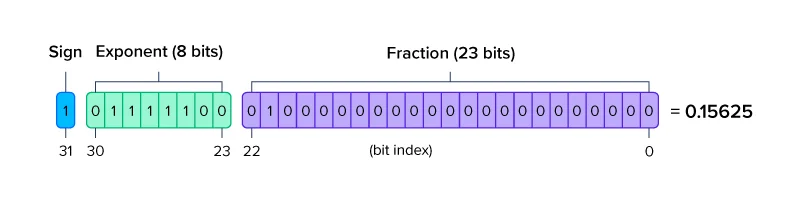

Remember that float32's `E8` stores a *biased exponent*: the represented real number is $s = 1.M \times 2^{E - 127}$. Thus `log2(s) = (E − 127) + log2(1.m)`, and `127` must be subtracted from `E8` to obtain ${\left\lfloor \log_2 s \right\rfloor}$.

Recall the classic C++ ceiling-division formula `(x - 1) / y + 1` for positive values, as opposed to floor division `x / y`. The ceil-log2 vs floor-log2 trick is analogous: replace `bits >> 23` with `((bits - 1) >> 23) + 1`. Subtracting one handles the boundary case. An exact multiple of `y`—or an exact power of two for log2—moves just below that boundary. Adding one after the shift restores the original result, while non-boundary values are effectively rounded upward. The biased-exponent adjustment `-127` remains, yielding the complete formula: ${\left\lceil \log_2 s \right\rceil}$ equals `((bits - 1) >> 23) + 1 - 127`.

Why not use floor-log2 and round $s$ downward instead? The resulting scale factor would cover too small a range, causing `q` to exceed FP8's representable maximum, `E4M3_MAX = 448.0`.

**3.2. Rounding Without Packing**

The previously computed `exp_sf = ((bits - 1) >> 23) + 1 - 127` is a view, in int32 form, of the "E8M0 exponent bits" obtained by shifting. Remember that the original input x must be divided groupwise by the scaling factor to produce FP8 `q`. The int32 `exp_sf` cannot be multiplied directly with float32 `x`—automatic type promotion would perform a real cast rather than a bit reinterpretation. Instead, shift it left by `<< 23` to return it to FP32's exponent position, then view (reinterpret-cast) it back to `float32` before multiplying it with `x`. This is required in real GPU/NPU kernels as well as PyTorch.

```python
# Before shifting left by 23, restore the previously subtracted 127 to satisfy FP32 encoding
sf = ((127 + exp_sf) << 23).view(torch.float32)
# Express 1/sf directly as 2^{-E}; place the bits in the correct exponent position,
# avoiding floating-point division
sf_inv = ((127 - exp_sf) << 23).view(torch.float32)

# Remember: before quantizing x to q, divide each group by the *rounded sf*, not the original
# high-precision sf, so the (q, sf) tuple remains consistent with the original x.
# `grouped` is the previously reshaped `x`.
q = (grouped * sf_inv.unsqueeze(-1)).view(m, k).to(torch.float8_e4m3fn)
```

Quick quiz: Section 3.1 shifts right by 23 bits, and Section 3.2 shifts left by 23 bits. Do they not cancel out and accomplish nothing? Why not simply mask off the mantissa bits while leaving the exponent bits in place, which would also extract the 8-bit exponent? Because that cannot correctly express rounding log2 upward; you would still need a branch depending on whether M is zero.

**3.3. Packing (So E8M0 Occupies Only 8 Bits) Requires One More Step**

There is no native `torch.e8m0` array type. TileKernels quantization kernels store E8M0 bits in a `torch.int16` array, with each int16 scalar representing two scaling factors:

```python
# Note: this is .to, not .view; it really casts int32 to an 8-bit uint8
e8m0 = (exp_sf + 127).to(torch.uint8)
lo = e8m0[..., 0::2].to(torch.int16)  # The right-hand 8 bits of the 16-bit value
hi = e8m0[..., 1::2].to(torch.int16)  # The left-hand 8 bits of the 16-bit value
packed = lo | (hi << 8)  # OR the left and right halves together
# `packed` is written back to global memory
```

<a id="patterns"></a>
# Classification by Operation Pattern

DeepSeek's open-source TileKernels places many of the variants above in a single kernel file and uses numerous `config` fields for compile-time branching within the kernel. I extracted them into standalone small patterns in [tilelang-puzzles-ascend](https://github.com/PTO-ISA/tilelang-puzzles-ascend/tree/simt_compare), following the easy-to-hard, step-by-step style of [tilelang-puzzles](https://github.com/tile-ai/tilelang-puzzles) to make them easier to learn. The quantization kernels fall into the following categories by complexity and algorithmic pattern:

| | cast_back | per_token | per_block | per_channel |
|---|---|---|---|---|
| 01 | FP8 + FP32 scale, either output dtype | raw FP32 scale | raw, 32×32 tile | raw, reduce along M |
| 02 | packed UE8M0 | `round_sf` (pow2) | `round_sf` + packed | packed along **M** |
| 03 | `sf_block=(32,32)` | packed UE8M0 | FP4 output | requant + bf16 |
| 04 | `sf_block=(32,1)` | fp32 input / FP4 output | column-major scales | composed |
| 05 | FP4 input | column-major scales | split + composed | |
| 06 | column-major, composed | `sf_only`/`cast_only`, requant | | |
| 07 | | bf16 compute, composed | | |

Each variant has four implementations:
- `ASC`, extracted from DeepSeek's official TileKernels SIMD implementation but reduced to one branch/variant;
- `PTO`, a simplified SIMD implementation ported by our PTO team;
- `SIMT`, mostly extracted from DeepSeek's official CUDA implementation, with minor changes in a few cases so it runs in Ascend SIMT mode;
- `torch`, a pure mathematical reference extracted from the unit-test reference implementation.

None of the examples in this article consider GM<->UB DMA (`T.copy`), multicore scheduling (`T.Persistent`), or anything else outside the VF. Those parts are compatible with TileLang's mature GPU syntax and require no NPU-specific APIs.

First, here is a high-level count of the lines inside the `SimdVF` and `SimtVF` regions, used as a rough proxy for programming complexity:

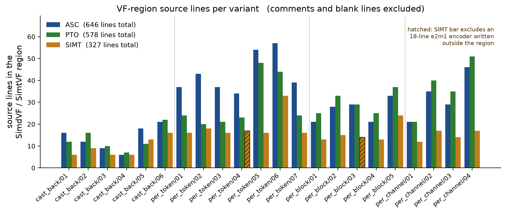

For "SIMD-friendly kernels," such as the `per_token_cast` family, which mostly "reduces 32 contiguous values in memory," PTO SIMD is nearly as short as SIMT and already simple enough. ASC is verbose because the physical instructions are too low-level, not because of "SIMD in the broad sense." For "strided-memory-access kernels," such as "transpose to column-major," SIMT genuinely takes fewer lines. In general, SIMT code is shorter and easier to understand for patterns involving transpose, gather, 2D/3D broadcast and reduction, irregular strides, algorithm-level interleaving, and other flexible memory accesses. In principle, a SIMD abstraction could escape its one-dimensional limitations and add higher-order, PyTorch/NumPy-like APIs for high-dimensional reduce/broadcast/gather/scatter. That would, however, expand the API surface: more functions for users to memorize and agents to look up. (More APIs are not always better. I bet even algorithm engineers need a few seconds the first time they encounter the high-dimensional semantics of `torch.gather`/`torch.scatter`; an even more complicated API would be a tough sell.)

<a id="simd-simple"></a>
## Cases Where SIMD Is Already Simple and Intuitive

### `per_token_cast/01` -- Grouped Reduction over Contiguous Memory

The SIMT implementation is:

```python
# Note: `x_ub = T.alloc_shared((hidden,), T.bfloat16)` is allocated outside the VF;
# its values come from a GM T.copy.

# The code below is a fragment inside a `with T.SimtVF(threads=THREADS):` scope.
x_l = T.alloc_fragment((num_groups, group_size), T.float32)
amax_l = T.alloc_fragment((num_groups,), T.float32)

# Read the 1D `x_ub` from UB into registers, reshape it to the 2D `x_l`,
# and convert bfloat16 to float32.
# Analogous PyTorch: x_l = x_ub.reshape(num_groups, group_size).to(torch.float32)
for g, j in T.Parallel(num_groups, group_size):
    x_l[g, j] = T.Cast("float32", x_ub[g * group_size + j])

# Reduce along the `group_size` axis.
# Analogous PyTorch: `amax_l = x_l.amax(dim=1)`
T.reduce_absmax(x_l, amax_l, dim=1)
```

The PTO SIMD implementation is:

```python
# As above, `x_ub = T.alloc_shared((hidden,), T.bfloat16)` is allocated outside the VF.
# The code below is a fragment inside a `with T.SimdVF():` scope.

# As above: load UB -> Reg and cast bfloat16 to float32.
x = V.vcvt(V.vload(x_ub[col], size=PAIR), "float32")

# Grouped reduce-max (`vcmax` takes a group parameter); write the result back to UB.
V.vstore(V.vcmax(V.vabs(x, mask), mask, group=groups_per_pair),
         amax_ub[group])
```

The [`vcmax` instruction](https://github.com/PTO-ISA/PTO-Gym/blob/main/docs/PTO-vmi-Instruction-SPEC.md#ptovmivcmax--ptovmivcmin) plus `vabs` is equivalent to the reshape + `T.reduce_absmax` effect in the SIMT code. The CA model shows that this SIMD code takes *nearly half as many cycles* as SIMT mode; see the performance summary below.

The ASC SIMD implementation is much harder to read. This follows from the constraint explained earlier: "a physical SIMD register is always 256 bytes long regardless of type, so a type cast changes the **number** of registers." Consequently, AscendC code is full of places where two to four registers represent one set of variables with the same mathematical meaning, requiring the same API to be called two to four times.

```python
a0 = S.vabs(S.vcvt(S.vld(x_ub[col], dist="UNPK_B16"), T.float32))
a1 = S.vabs(S.vcvt(S.vld(x_ub[col + LANES], dist="UNPK_B16"),
                    T.float32))
# Each register holds two groups, so reduce half at a time.
S.vsts(amax_ub[group], S.vcmax(a0, mask_low), dist="ONEPT_B32")
S.vsts(amax_ub[group + 1], S.vcmax(a0, mask_high),
        dist="ONEPT_B32")
S.vsts(amax_ub[group + 2], S.vcmax(a1, mask_low),
        dist="ONEPT_B32")
S.vsts(amax_ub[group + 3], S.vcmax(a1, mask_high),
        dist="ONEPT_B32")
```

PTO aims to abstract away this low-level code, so I will not explain it further. Interested readers can consult the lower-level [Micro Instruction Spec](https://github.com/PTO-ISA/PTO-Gym/blob/main/docs/PTO-micro-Instruction-SPEC.md).

<a id="simt-simd-similar"></a>
## Cases Where SIMT and SIMD Differ Only Slightly

### `per_token/02`, `cast_back/02` -- Bit-Twiddling

When most of the lines implement a complicated mathematical formula composed mainly of elementwise operations, SIMD and SIMT are equally long. The "round FP32 -> E8M0 upward" bit trick explained with PyTorch before is a typical example.

The logic previously shown in PyTorch appears verbatim in the TileLang code. `CLAMP_MIN` prevents "zero divided by zero." PyTorch's `.view(int32)`—or TileLang's `T.reinterpret("int32")`—enables bit operations on floating-point values. The "ceil-log2 bit trick," `((bits - 1) >> 23) + 1`, computes log2 rounded upward. Finally, the FP32 biased-exponent format requires subtracting `127`; the `254` below combines `127 - exp_sf = 127 - (biased - 127)`:

```python
# Fragment inside a `with T.SimtVF(threads=THREADS):` scope.
for g in T.Parallel(num_groups):
    amax = T.max(amax_l[g], E4M3_CLAMP_MIN)
    bits = T.reinterpret("int32", amax / E4M3_MAX)
    biased = ((bits - 1) >> 23) + 1
    sf_l[g] = T.reinterpret("float32", biased << 23)
    inv_l[g] = T.reinterpret("float32", (254 - biased) << 23)
```

The current PTO code looks like this:

```python
# Fragment inside a `with T.SimdVF():` scope.

# Note: `V.vbrc(const)` broadcasts a scalar into a SIMD register,
# equivalent to `S.vdup` in the ASC example.
clamped = V.vmax(amax, V.vbrc(T.float32(E4M3_CLAMP_MIN), size=lanes))
one = V.vbrc(T.uint32(1), size=lanes)
shift = V.vbrc(T.uint32(23), size=lanes)
bits = V.vinterpret_cast(
    V.vmul(clamped, V.vbrc(T.float32(inv_qmax), size=lanes), mask), "uint32")
biased = V.vadd(V.vshr(V.vsub(bits, one), shift), one)
sf = V.vinterpret_cast(V.vshl(biased, shift), "float32")
inv = V.vinterpret_cast(
    V.vshl(V.vsub(V.vbrc(T.uint32(254), size=lanes), biased), shift), "float32")
```

It looks wordier than SIMT only because it lacks syntactic sugar for operator overloading. Suppose we overload `__add__`, `__mul__`, `__sub__`, `__rsub__`, `__rshift__`, and `__lshift__`, and automatically promote a participating Python scalar `const` to `V.vbrc(T.uint32(const), size=lanes)`. The SIMD code becomes just as concise:

```python
# Fragment inside a `with T.SimdVF():` scope.
clamped = V.vmax(amax, E4M3_CLAMP_MIN)
bits = V.vinterpret_cast(clamped * inv_qmax, "uint32")
biased = ((bits - 1) >> 23) + 1
sf = V.vinterpret_cast(biased << 23, "float32")
inv = V.vinterpret_cast((254 - biased) << 23, "float32")
```

It further saves the line of `T.Parallel`.

### `per_channel/01` Serial Reduction

SIMT and SIMD do not differ for strictly serial operations. A typical example is per-channel quantization, which finds the maximum sequentially down noncontiguous columns.

CUDA-like SIMT:

```python
# Fragment inside a `T.SimtVF(threads=THREADS)` scope.

# Compare values serially along the `row` dimension of x_ub[row, c],
# retaining the largest absolute value.
for c in T.Parallel(hidden):
    amax = T.alloc_var(T.float32)
    # Initialize to E4M3_CLAMP_MIN so the result cannot be smaller;
    # this is equivalent to torch.clamp.
    amax = E4M3_CLAMP_MIN
    for row in T.serial(group_tokens):
        amax = T.max(amax,
                     T.abs(T.Cast("float32", x_ub[row, c])))
    sf_ub[c] = amax / E4M3_MAX
    inv_ub[c] = E4M3_MAX / amax
```

PTO SIMD:

```python
# `alloc_local` allocates a local array of vector registers of length one;
# `acc[0]` can be assigned repeatedly as the loop accumulator.
acc = V.alloc_local((1,), V.vreg(LANES, T.float32))
# As above, initialize to E4M3_CLAMP_MIN.
acc[0] = V.vbrc(T.float32(E4M3_CLAMP_MIN), size=LANES)
for row in T.serial(group_tokens):
    v = V.vabs(V.vcvt(V.vload(x_ub[row, col], size=LANES),
                      "float32"), mask)
    # Lane c holds the maximum over the tokens seen so far.
    acc[0] = V.vmax(acc[0], v, mask)
V.vstore(V.vdiv(acc[0], qmax, mask), sf_ub[col])
V.vstore(V.vdiv(qmax, acc[0], mask), inv_ub[col])
# Note: `col` is the outer-loop index; the full vector is processed
# in increments of the SIMD length.
# `qmax` is a SIMD register created outside the scope and filled with
# `E4M3_MAX=448.0`: `qmax = V.vbrc(T.float32(E4M3_MAX), size=LANES)`.
```

The few verbose spots in PTO syntax need only a little syntactic sugar: overload `V.vdiv` as `/`; simplify the API for creating the scalar `acc[0]`; omit the default `mask` (all lanes active, no masking); and reuse the previously-suggested type promotion `Python constant -> V.vbrc`. It then looks just as short as the SIMT example. The remaining difference vs SIMT is that `for c in T.Parallel(hidden)` is absorbed into the vector-operation APIs:

```python
# Mock SIMD style with syntactic sugar.
amax = V.alloc_var(T.float32)  # Represents a scalar, not a vector register.
amax = E4M3_CLAMP_MIN
for row in T.serial(group_tokens):
    v = V.vabs(V.vcvt(V.vload(x_ub[row, col], size=LANES), "float32"))
    amax = V.vmax(amax, v)
V.vstore(amax / qmax, sf_ub[col])
V.vstore(qmax / amax, inv_ub[col])
```

<a id="simt-slight-advantage"></a>
## Cases Where SIMT Has a Small Advantage

For strided memory access with a fairly regular stride, SIMD code is not complicated; you merely need to know the specialized API's name. SIMT is slightly more intuitive.

### `cast_back/01` Group Broadcast

Consider 1D dequantization: groupwise-multiply a scaling-factor array of length `hidden/group_size` into `q` of length `hidden`, with every `group_size` (usually 32) q values sharing one sf. The SIMT syntax is:

```python
for i in T.Parallel(hidden):
    o_l[i] = q_l[i] * sf_ub[i // group_size]
```

Grouped-Query Attention has a similar algorithmic pattern: several queries share one key/value, so kv must effectively be broadcast before multiplication with q.

[cast_back_cuda.py](https://github.com/deepseek-ai/TileKernels/blob/v2.1.0-release/tile_kernels/quant/cast_back_cuda.py#L78-L79) generalizes this to a two-dimensional broadcast. Two simple lines support dequantization over {1D/2D, by row/by column}:

```python
for i, j in T.Parallel(TILE_M, TILE_K):
    out_fragment[i, j] = x_shared[i, j] * sf_shared[i // num_per_tokens, j // num_per_channels]
```

`i // group_size` implements grouped broadcasting of `sf`. PTO SIMD mode has a dedicated load-broadcast instruction:

```python
scale = V.vload(sf_ub[group], size=LANES, stride=1,
                dist_mode="brc", group=groups_per_strip)
scaled = V.vmul(values, scale, mask)
```

As long as the user or agent knows this API exists, it is also only two lines.

The SIMD instructions in [cast_back_asc.py](https://github.com/deepseek-ai/TileKernels/blob/v2.1.0-release/tile_kernels/quant/cast_back_asc.py#L123-L128) are twice as verbose. The user or agent must know that `vld` has a `BRC_B32` mode and manually combine two physical registers.

```python
lo = S.vld(sf_ub[group], dist="BRC_B32")
hi = S.vld(sf_ub[group + 1], dist="BRC_B32")
scale = S.vsel(lo, hi, mask_low)
scaled = S.vmul(values, scale)
```

### `per_channel/02` Algorithm-Level Interleave

Consider packing E8M0 into an INT16 array. Packing along rows uses contiguous reads and writes; packing along columns requires moving two nonadjacent values next to each other, which involves noncontiguous writes. An illustrative SIMT version is:

```python
for c in T.Parallel(hidden):
    packed_ub[PACK_FACTOR * c] = sf_rows_ub[0, c]
    packed_ub[PACK_FACTOR * c + 1] = sf_rows_ub[1, c]
```

This is equivalent to a transpose that turns "noncontiguous sf values across rows" into contiguous packed values. It is simplified from the more general TileLang SIMT code in [`get_sf_index` in `tile_kernels/quant/common.py`](https://github.com/deepseek-ai/TileKernels/blob/v2.1.0-release/tile_kernels/quant/common.py#L285-L294):

```python
    if config.sf_col_pack:
        return m_idx // pack_factor, k_idx * pack_factor + m_idx % pack_factor
    if config.use_packed_ue8m0 and config.use_tma_aligned_col_major_sf:
        return k_idx // pack_factor, m_idx * pack_factor + k_idx % pack_factor
    if config.use_tma_aligned_col_major_sf:
        return k_idx, m_idx
    return m_idx, k_idx
```

This is a highly regular `[2, N]` transpose, for which the corresponding SIMD instruction is simply `interleave`:

```python
a = V.vload(sf_rows_ub[0, col], size=BYTE_LANES * 2)
b = V.vload(sf_rows_ub[1, col], size=BYTE_LANES * 2)
lo, _ = V.vintlv(a, b, byte_mask)
V.vstore(lo, packed_ub[col * PACK_FACTOR])
```

See the `AscendC:Interleave` diagram near the beginning of this article. **This transformation is unrelated to type casting; the memory-layout change is required by the algorithm.** PTO can eliminate AscendC's type-cast-related interleaves, *but it cannot eliminate this one*. The ASC implementation is the same:

```python
a = S.vld(sf_rows_ub[0, col], dist="NORM_B8")
b = S.vld(sf_rows_ub[1, col], dist="NORM_B8")
lo, _ = S.vintlv(a, b)
S.vsts(packed_ub[col * PACK_FACTOR], lo, dist="NORM_B8")
```

This is based on [`pack_sf_rows` in `per_channel_cast_asc.py`](https://github.com/deepseek-ai/TileKernels/blob/v2.1.0-release/tile_kernels/quant/per_channel_cast_asc.py#L222).

It is one of the rare cases where "PTO SIMD does not simplify ASC." SIMT really is easier to understand here because users need not know the `vintlv` instruction or its behavior.

<a id="simt-clear-advantage"></a>
## Cases Where SIMT Has a Clear Advantage

### `per_token/05` Transpose

The previous case was the special transpose `[2, N] -> [N, 2]`. For a more general transpose, SIMD mode cannot use the specialized `vintlv`; it needs the more general `vgather`. SIMT mode still uses the simple scalar subscript `A[j, i] = ...`.

When `out_config.use_tma_aligned_col_major_sf = True`, the scaling factors must be transposed from `[batch, group]` to `[group, batch]` before being stored. [`per_token_cast_asc.py` implements the transpose by calling `S.vgather2` in `transpose_vectors()`](https://github.com/deepseek-ai/TileKernels/blob/v2.1.0-release/tile_kernels/quant/per_token_cast_asc.py#L96-L113).

The CUDA/SIMT implementation is extremely simple: change one line. There is no need to understand how the `vgather` instruction behaves or to construct gather indices.

```python
# Identical to the `per_token/02` bit trick shown earlier; only the last line changes.
for g in T.Parallel(num_groups):
    amax = T.max(amax_l[g], E4M3_CLAMP_MIN)
    bits = T.reinterpret("int32", amax / E4M3_MAX)
    biased = ((bits - 1) >> 23) + 1
    inv_l[g] = T.reinterpret("float32", (254 - biased) << 23)
    # Without transpose, store back to `[sub, g]`; to transpose, just swap the indices.
    sf_out_ub[g, sub] = T.reinterpret("float32", biased << 23)
```

Compare the PTO and ASC SIMD gather implementations:

```python
# PTO
V.vstore(V.vgather(sf_dense_ub[0, base], idx, gmask),
         sf_out_ub[base, 0])
# ASC
S.vsts(sf_out_ub[base, 0],
       S.vgather2(sf_dense_ub[0, base], idx), dist="NORM_B32")
```

The `gather` itself is only one line; constructing `idx` is the nuisance. [Inside `per_token_cast_asc.py`](https://github.com/deepseek-ai/TileKernels/blob/v2.1.0-release/tile_kernels/quant/per_token_cast_asc.py#L79-L93), the transpose indices are constructed based on whether packing is enabled (whether the values occupy FP32 or only 8-bit E8M0) and on the `pack_factor` (two here):

```python
    def init_transpose_indices(indices):
        with T.SimdVF():
            if out_config.use_packed_ue8m0:
                lane = S.vci(0, T.int16)
                output_row = S.vand(T.reinterpret(lane, 'uint16x128'), S.vdup(block_m - 1, T.uint16))
                group_in_vector = T.reinterpret(S.vshrs(lane, log2_block_m), 'uint16x128')
                source_indices = S.vadd(S.vmuls(output_row, sf_stride // pack_factor), group_in_vector)
                S.vsts(indices[0], source_indices, dist='NORM_B16')
            else:
                ...
```

Because no `vcvt`-induced change in register count occurs here, the PTO code is almost identical to this ASC code and cannot be simplified further. Overloading `vand`, `vdup`, `vadd`, `vmuls`, and `vshrs` with syntactic sugar can shorten the code, but it remains nowhere near as simple as SIMT's "change `x[i, j]` to `x[j, i]`":

```python
# init_transpose_indices simplified with syntactic sugar.
lane = S.vci(0, T.int16)
output_row = T.reinterpret(lane, 'uint16x128') & (block_m - 1)
group_in_vector = T.reinterpret((lane >> log2_block_m), 'uint16x128')
source_indices = output_row * (sf_stride // pack_factor) + group_in_vector
S.vsts(indices[0], source_indices, dist='NORM_B16')
```

This is because the SIMD-register abstraction is only one-dimensional. At the Reg level, PTO abstracts length but not dimensionality. Suppose we also defined 2D—or even high-dimensional—tiles at the SIMD Register File level of the memory hierarchy. With operations such as `tile.transpose()` and `tile.max(dim=1)`, this SIMD code could collapse to one line: `vstore(sf_out_ub, sf_reg.transpose())`. The compiler would, of course, need to map the `transpose` API to the `vgather` instruction, including construction of the gather indices.

The next example also operates on 2D tiles ↓

### `per_block/01` 2D Reduction

`per_block_cast` reduces across both rows and columns. Its SIMT implementation "first reshapes/transposes, then reduces along the inner axis":

```python
for i, j in T.Parallel(bm, bk):
    flat_l[0, i * bk + j] = T.Cast("float32", x_ub[i, j])
T.reduce_absmax(flat_l, tile_l, dim=1)
```

See [per_block_cast_cuda.py](https://github.com/deepseek-ai/TileKernels/blob/v2.1.0-release/tile_kernels/quant/per_block_cast_cuda.py#L77-L83) for the complete version:

```python
for i, j in T.Parallel(block_m, block_k):
    block_offset = (i % (num_threads * num_vectorize // block_k) * num_per_channels + j % num_per_channels) // num_vectorize
    amax_reducer[i // num_per_tokens, j // num_per_channels, block_offset] = T.max(
        amax_reducer[i // num_per_tokens, j // num_per_channels, block_offset],
        T.abs(x_fragment[i, j]),
    )
T.reduce_max(amax_reducer, amax_fragment, dim=2)
```

The scalar operations inside `T.Parallel` are equivalent to `reshape + permute`; recall the PyTorch expression near the beginning, `.view(m // bm, bm, k // bk, bk).permute(0, 2, 1, 3)`. The `T.reduce_max` line is a TileLang primitive, not SIMT syntax, and uses its `dim` parameter for grouped reduction.

The PTO SIMD implementation performs parallel reduction within rows (`V.vcmax`) and serial reduction across rows (`T.serial`):

```python
# Perform grouped 1D reductions along rows and write intermediate results to run_ub.
for chunk in T.serial(num_chunks):
    v = V.vabs(V.vcvt(V.vload(flat_x[chunk * LANES],
                              size=LANES), "float32"), mask)
    V.vstore(V.vcmax(v, mask, group=1), run_ub[chunk])

# Reduce the grouped results one more time to obtain the absmax of the 32x32 tile.
partials = V.vload(run_ub[0], size=LANES)
tile_amax = V.vcmax(partials, mask_chunks, group=1)
```

As with the transpose example, if PTO supported reshaping/permuting 2D tiles and `max(dim=1)`, the code could be as short as PyTorch. But if we keep adding so-called "high-level SIMD APIs," the frontend grows increasingly unlike CUDA. Is that a benefit or a burden for the community?

<a id="special-cases"></a>
## Special Cases

### `per_token/04` FP4 Not Supported in SIMT

Finally, there is a special case that Ascend SIMT mode cannot express: casting to and from FP4. GPUs provide the [`__nv_fp4_e2m1` family of primitives](https://docs.nvidia.com/cuda/cuda-math-api/cuda_math_api/struct____nv__fp4__e2m1.html), and TileLang's `per_token_cast_cuda.py` supports `T.cast` to `T.float4_e2m1fn`. Ascend 950's SIMT ISA simply lacks an FP4 conversion instruction, so conversion is possible only in SIMD mode.

E2M1 can be emulated in software with integer bit operations inside `SimtVF`:

```python
bits = T.reinterpret("int32", v)
# bit 3 of (bits >> 28) is bit 31 of bits: the sign nibble, without
# depending on whether >> sign-extends.
sign_nib = (bits >> 28) & 0x8
exps = (bits >> 23) & 0xFF
mant = bits & 0x7FFFFF
```

See [simt/per_token/04_fp32_in_fp4_out.py](https://github.com/PTO-ISA/tilelang-puzzles-ascend/blob/simt_compare/puzzles/simt/quant/answer/per_token/04_fp32_in_fp4_out.py) for complete runnable code.

Its performance is terrible: 90 times as many cycles as native SIMD, as shown in the next section. Moving only the cast step to SIMD while leaving everything else in SIMT reduces that from 90× slower to just 1.26× slower.

```python
# Most of the code is SIMT.
with T.SimtVF(threads=THREADS):
    ...
    # Use `T.Parallel` and `T.reduce_absmax` for reduction and scaling,
    # as explained above.

# Leave the final cast to FP4 to SIMD.
with T.SimdVF():
    for pair in T.serial(hidden // PAIR):
        S.vsts(q_ub[pair * PAIR],
                S.vcvt(S.vld(bf_ub[pair * PAIR]),
                        T.float4_e2m1fn),
                dist="PK4_B32")
```

<a id="perf-vf"></a>
# Performance Comparison (VF Simulation)

I have been unable to connect to a machine recently, so for now I ran the CA model to obtain Vector Function cycle counts; on-device measurements will come next time. The benchmark launches a single-core kernel with `T.Kernel(1)`, excludes the cost of `T.copy` DMA, ignores GM<->UB pipelining and multicore scheduling quality, and looks only at the local code where SIMD and SIMT differ. It uses `msopprof simulator`; see the [msOpProf Simulator Mode User Guide](https://gitcode.com/Ascend/msopprof/blob/master/docs/en/user_guide/msopprof_simulator_user_guide.md).

The raw data for this section is in [quant_vf_cycles.json](https://github.com/PTO-ISA/tilelang-puzzles-ascend/blob/simt_compare/perf/quant_vf_cycles.json). The results can be reproduced in a CPU + Docker environment and are measured entirely with the TileLang DSL plus msprof's built-in CA model—no hand-written AscendC and no physical NPU required.

For the same algorithm and shape, SIMT takes anywhere from 1.2× to 10× as many cycles. Note that these are VF simulation results, not the performance gap on real hardware. If VF execution is brief and the kernel is memory-bound, a moderate difference in cycle count will not affect measured end-to-end runtime.

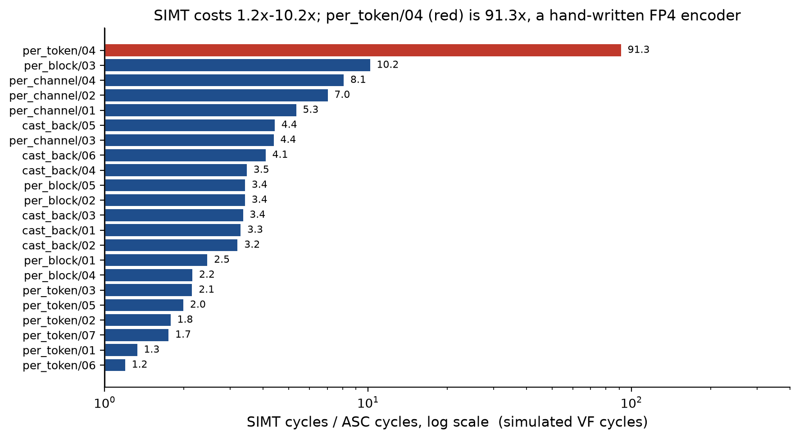

- The 90× result in the first row is a special outlier caused by brute-forcing FP4 with SIMT bit operations.
- Cases where SIMT is more than 3× slower than SIMD, such as `per_channel` and `per_block`, are usually also the cases where SIMT syntax is markedly simpler. SIMD must select the proper broadcast, interleave, and gather instructions, while SIMT gets the job done by fiddling with two lines of indices.
- If the compiler can automatically map these cases from a SIMT DSL frontend to a SIMD hardware backend—similar to implementing GPU coalescing in software, or to an auto-vectorizing compiler capable of handling complicated high-dimensional patterns—we can retain compatibility with GPU CUDA-like code while also reaching Ascend 950's peak performance.

Now compare PTO vs ASC, both using SIMD. These results use [PTOAS `vmi-v0.1.9`](https://github.com/hw-native-sys/PTOAS/releases/tag/vmi-v0.1.9); later versions may include further optimizations.


Again, a 30% faster VF does not mean 30% faster on-device performance. In many cases the ASC baseline is already optimized to be memory-bound, so reducing VF time produces no visible improvement.

Based on earlier profiling, PTO is faster in some cases because its lowering pass finds better instruction types and ordering. Compute instructions (`vadd`/`vmul`) cannot be eliminated, but layout-manipulation instructions such as interleave/pack often have several equivalent formulations. Removing a few interleave instructions simplifies instruction dependencies and reduces bubbles in the out-of-order pipeline.

Take MXFP8 -> BF16 dequantization as an example. The profiling charts show:

Hand-written ASC/CCE, VF time 144 us

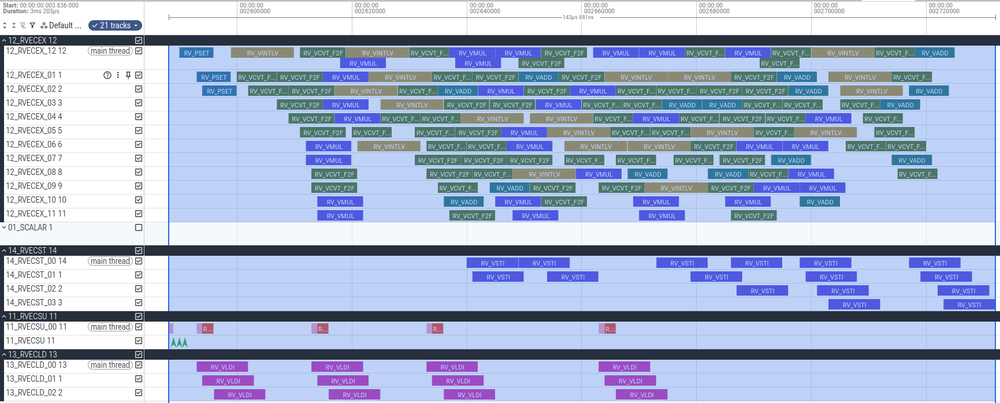

Lowered through PTO.VMI, VF time 113 us

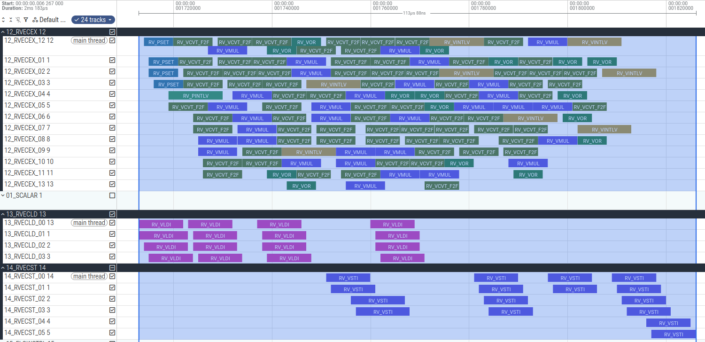

The counts show 16 `VADD` instructions and 32 `VMUL` instructions in both versions, but ASC uses 20 `VINTLV` instructions while PTO uses only 8, producing fewer pipeline bubbles.

In theory, one could manually write ASC with the same instruction ordering produced by PTO lowering and achieve identical performance. The PTO compiler captures common transformations in passes so we do not repeatedly waste tokens—or human effort—searching for the optimum.

<a id="open-questions"></a>
# Open Questions

In the age of agentic programming, does it really matter to spend this much of an article discussing "reducing programming complexity"? At this stage, "code that humans can understand, review, and maintain" remains a major advantage. I, for one, still do not dare merge code I cannot understand... Even if agents have nearly taken over kernel writing, you still have to read what they wrote (~~and take the blame for it~~), right?

I recently read [slime v0.3.0: Toward the Agent Era](https://zhuanlan.zhihu.com/p/2044533166694732929), which discusses "agent-assisted project maintenance," and it strongly resonated with me:

> In my view, programming with coding agents introduces two major risks.
>
> The first is a personal-attention DDoS caused by explosive code growth: code output increases, but maintainers' ability to review, understand, and absorb those changes does not keep pace. Eventually, there is simply more than they can handle.
>
> The second is a loss of ownership caused by reduced human involvement: when developers no longer truly understand why the code is designed this way and stop viewing it as their own work, the project's architectural quality gradually deteriorates through one "seems to run" change after another.

Another common question concerns automatic `T.Parallel` -> PTO SIMD conversion. Users can write bizarre patterns with *extremely memory-unfriendly access*; flexible scalar syntax such as `x[i, j]` gives them plenty of rope. Will the compiler sometimes fail to analyze such code, or produce a suboptimal result? Certainly. I can manufacture arbitrarily bad, meaningless test cases. But the lowering pass can be best-effort: successful conversion is a free performance lunch; if analysis fails, it can fall back to SIMT mode, or report an error and return the user to hand-written SIMD development. None of these outcomes makes the user's situation worse. This resembles the design logic of `torch.compile`: handle what you can, and at least fall back to eager execution when you cannot.

Compared with SIMT-style `T.Parallel` plus scalar indexing, the easier route for an NPU compiler is unquestionably to *expand the high-level SIMD API surface*: add a collection of PyTorch/NumPy-like high-dimensional reshape/transpose/reduce/broadcast/gather/scatter operations. That requires only lowering, not lifting. To borrow [a diagram from Prof. Paul Kelly](https://wp.doc.ic.ac.uk/spo/), going downhill is much easier than going uphill:

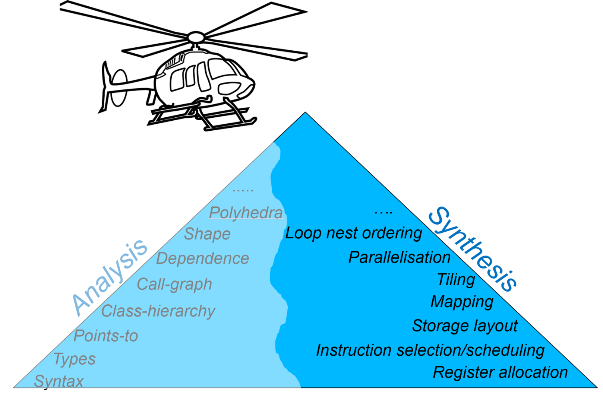

In fact, Triton's `tl.max(axis=...)`, `tl.reshape`, and `tl.broadcast` already satisfy the requirements of a "high-dimensional tile API." Unfortunately, native Triton's `tl.load(pointers)` is not friendly to NPU memory hierarchies or DMA parameters. TileLang's `T.copy` and multilevel `T.alloc_xxx` fit NPUs better. Only `T.Parallel` syntax—an excellent design on GPUs (why *wouldn't* you exploit hardware-based coalescing when it is right there?)—becomes a cross-hardware compatibility challenge on SIMD NPUs.
